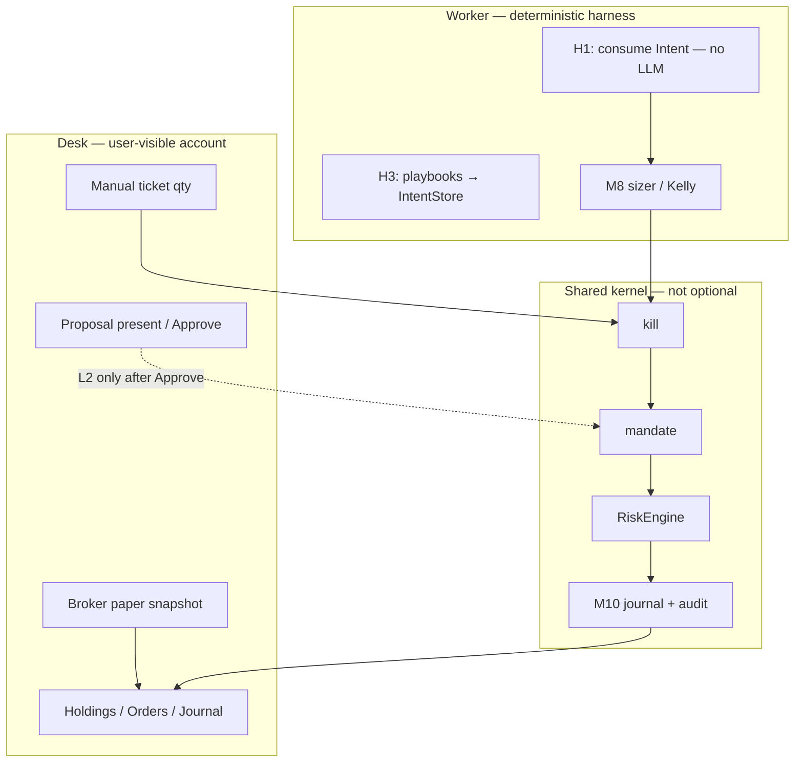

# 管戶設計頁｜Account Management Design

> **Status:** Draft（plan-15）— 待 Owner／PM 審；**未 Accepted、未 merge 前唔作產品宣稱依據。**  
> **Binds under:** [ADR-003 + Addendum A](ADR-003-live-ai-trading-desk.md)（Accepted）> [MODULAR_ARCHITECTURE.md](MODULAR_ARCHITECTURE.md) > [AUDIT_REMEDIATION_PLAN_2026-10-21.md](AUDIT_REMEDIATION_PLAN_2026-10-21.md)（Confirmed items 1–5）> [BOUNDED_INTELLIGENCE_ACCEPTANCE.md](BOUNDED_INTELLIGENCE_ACCEPTANCE.md)（Draft：有界智能接受條件；本頁寫管戶**產品範圍**）。  
> **Index:** [ARCHITECTURE_DECISION.md](ARCHITECTURE_DECISION.md)。**ADR-002 is VOID.**  
> **North star（鎖定）：** 遠端交易台（迷你富途＋TradingView 可讀性）；用戶可見可追溯日誌；AI 幫管戶（美股／期權，之後可加黃金）；**唔係**淨後台 Python 指標工具；真倉要過證據閘。  
> **Does not elevate:** Intent→M8／H1–H3、D7-DESIGN（雙目錄合併）、Desk flatten product exception、fake verified／live、lab `advisory_debate`→`OrderManager`。Issue #10 stays OPEN.  
> **Does not rewrite:** live Harness config／strategy／rules；L2 憲法只經 Proposal→Approve→Merge。  
> **Date:** 2026-10-23（Asia/Hong_Kong）  
> **Baseline SHA:** `806f3052bdbf4988a77cdcb64025bb7991696ba8`（`main`，含 flatten PR #32）

---

## 1. 目的｜Purpose

用**一頁**寫清北極星（north star）「**AI 幫管戶**」喺 Desk（產品）同 worker（確定性 harness）分別指咩、唔指咩。  
本頁係**設計／接受頁**，唔係實作工單、唔係保證盈利、唔係「可上真倉」證書、唔係把 Kelly 實驗室組合當券商帳。

對齊缺口：審計已指出「管戶智能未模組化」；有界智能頁（plan-14）鎖定 **veto／tier／digest** 接受條件；本頁鎖定 **帳戶面**——用戶睇到、worker 執行、證據閘、風控邊界、日誌溯源、期權／黃金分期。

---

## 2. 管戶係咩／唔係咩｜Definition

北極星原文精神：App 用 AI **幫管交易帳戶**（美股／期權，之後可加黃金）——體驗似迷你富途但更易讀。

| 是（v0 接受範圍） | 不是 |
|-------------------|------|
| **一本地主帳本：** Desk 券商紙倉（Alpaca paper snapshot + `backend/data/` journal／ledger） | 把 Streamlit Kelly／`data/` 模型組合當「已管戶」或同一本帳 |
| 用戶喺 Desk **睇到**權益／持倉／訂單／拒絕原因／日誌，可點開 provenance | 只得後台 worker.log；或帳已載入就當 worker 喺跑 |
| AI 喺 **帳戶層**做閉合 veto、conviction **tier**、解讀、digest→**Proposal**（見有界智能頁） | AI／LLM／Telegram **落單**；傳 raw size；靜默改 mandate／kill／風險％／live |
| Desk 手動單同 worker 自動單都過 **同一套** Mandate／Risk 硬閘（O5：worker 會拒嘅 Mandate／Risk，Desk 唔可以 broker-succeed）。**Kill 語意可以不對稱**（對齊 §4／§6／G2／§11 同 `806f305`）：Desk 買＋賣皆 409；worker 擋新 **BUY**，flatten／exit **SELL** 仍經 Mandate→Risk→OrderManager。Desk flatten 產品例外維持 OPEN（G2），本頁唔升格 | Desk 直呼 broker 當已風控；把 Desk 操作員 qty 當 M8 sizer 已算；要求 Desk／worker kill **完全同一**（禁止「一邊擋一邊過」）——呢個同 PR #32 衝突 |
| 每筆由訊號／票→閘→submit／reject→fill／unpriced **用戶可見** | 未成交 limit、shadow 估價、KPI 空倉當 verified／live／回測成績 |
| 股票為主；期權＝研究／鏈／計劃產物（見 §8） | v0 期權真倉／裸賣／保證金期權執行 |
| 黃金＝**之後可加**（現有 `defensive_gld` 仍係操作員揀嘅具名策略） | 黃金／商品 SKU、自動轉 GLD 當預設 |

**接受陳述：** 管戶＝**遠端 Desk 上、對用戶誠實嘅帳戶生命週期**（睇＋記＋閘＋輔助判斷），外加 worker 喺硬風控上執行已批准意圖。唔係「Python 幫你自動發財」，亦唔係 M1 登入／偏好 CRUD 本身。

M1（`backend/accounts/`：User／session／SavedPlan／研究用 `OptionPosition`）**可以**做身份與研究計劃載體；**唔等於**交易帳本。交易帳本係 broker paper ＋ M10 journal。

---

## 3. 現況（對齊本 SHA，唔發明）｜Repo truth

本節係設計約束，唔係升格已完成項。

| 面 | 現況（`806f305`） | 含義 |
|----|-------------------|------|
| 產品 UI | FastAPI Desk + `web/static`；Streamlit＝lab／legacy | 管戶 UX 落 Desk，唔復活 Streamlit 當商業面 |
| 券商帳 | `GET /api/account`＝Alpaca paper snapshot；持倉／訂單另有 honesty envelope | 帳戶載入 ≠ worker 運行 ≠ live |
| 雙帳本 | Kelly／lab 寫 repo `data/`；Desk journal／ledger 寫 `backend/data/` | **D7-HONESTY 已標**（PR #30）；**D7-DESIGN 仍 OPEN**（唔合併） |
| Desk 落單 | `place_desk_order`：kill（買＋賣 409）→ Mandate fail-closed → RiskEngine → OM＋journal；**保留操作員 qty** | R1-SAFE／R1-PATH journal stamp／O5 **Mandate＋Risk** 閘已合入（**唔含** kill 賣側對稱）；**Kelly／M8 sizer 仍 worker-only** |
| Worker 落單 | kill 擋新買；flatten／exit **賣**仍經 Mandate＋Risk＋OM（PR #32） | **唔**發明 Desk flatten 產品例外 |
| Intent | `intent.v0` JSON store＋H3 writer＋薄 H1 consume hook | **Intent→M8／完整 H1–H3 仍 OPEN**；Desk 手動票**唔寫** IntentStore |
| Journal | Desk `More → Trade journal`；reject／fill／audit 連結 | P0 可見性已有；空 journal ≠ live fill |
| 有界智能 | 接受頁 Draft；產品 `backend/trading/advisory/` 仍 TBD | M7 未當管戶引擎 |
| Lab debate | `backend/lab/advisory_debate.py` 隔離測通過 | **禁止**接到 `OrderManager` |
| 期權頁 | Desk Options＝鏈／研究檢視；M1 有研究用期權計劃欄位 | **唔係**期權執行帳 |
| 黃金 | 具名策略 `defensive_gld`（操作員揀，非預設） | **唔係**黃金產品 SKU |

---

## 4. Scope — Desk vs worker｜邊個「管」咩

兩條錢路徑可以分開（O5 已承認 dual-path），但**帳戶真相只有一個**：broker paper ＋ `backend/data/` 日誌。Lab Kelly 帳係對照／研究，唔餵產品「已管戶」文案。

| 關注點 | Desk（產品，用戶面） | Worker（harness，執行面） |
|--------|----------------------|---------------------------|
| **帳戶快照** | 展示 paper 權益／持倉／現金；chip「Account loaded」**唔**點亮 AUTO | 同一 broker snapshot 餵閘同 sizing |
| **手動票** | 操作員 qty／limit；必須過 kill＋Mandate＋Risk；journal `strategy_id=desk_manual` | 唔消費 Desk 票當 Intent |
| **自動開倉** | 用戶 Start paper auto；唔喺聊天落單 | H3 寫 Intent；H1 消費經 **M8 sizer**（完整接線仍 OPEN） |
| **倉位尺寸** | 手動＝操作員負責 qty，閘可拒；**唔**假裝已 Kelly | 自動＝Kelly／RiskLimits；conviction 只選 **已允許 tier** |
| **Kill** | 買＋賣皆 409（D-sell-kill）。Desk flatten 例外＝**OPEN 決策**（§10） | 擋新買；持倉 flatten／exit 賣可過閘（已合入，唔升格 Desk） |
| **AI 管戶** | 解讀、why-no-trade、veto／tier 展示、digest→Proposal 畀人批 | 消費已寫 Intent；**H1 無同步 LLM** |
| **日誌** | 用戶可見時間線；拒絕原因唔可藏 | 寫 audit＋TradeLogEntry；失敗單餵 Proposal digest |
| **L2 憲法** | 只展示／批准 Proposal | 未 Approve **零**改 mandate／kill／風險％／live |

**Desk flatten：** 而家 sell-while-killed＝409。若日後要「用戶一鍵平倉穿過 kill」，必須 **Gabriel 另決** 先開產品例外——本頁**不批准**把 worker 嘅 `worker_kill_blocks_side` 搬入 Desk。

---

## 5. 證據閘｜Evidence gates（無假 verified／live）

對齊 ADR-003 §4 C／D4 同有界智能頁 §7。管戶 UI／API **永遠**唔准用帳戶載入、paper KPI、或雙帳本標籤去 stamp `verified: true`／`live: true`。

| 閘 | 管戶含義 | 失敗必須看起來失敗 |
|----|----------|--------------------|
| Paper ≠ live | Desk 頂欄 PAPER；live 要人簽＋`--allow-live` | 唔顯示 Live ready／真倉徽章 |
| Filled-only | 只計有 **recorded fill price** 嘅成交 | 無價 → unpriced／唔升格 filled；未成交 limit ≠ 證據 |
| Account chip ≠ worker chip | 帳已載入同 AUTO ON 分開（D4） | 過期 heartbeat／死 pid 唔准當 ON |
| Dual book | 兩目錄就講兩本帳；合併前 `design_open=true` | 唔准「已統一帳戶」文案 |
| Local store | broker 讀失敗時 `local/unverified` | 唔准當乾淨券商簿 |
| KPI | paper.risk 來源；空倉 cue | 空 paper 簿 ≠ 回測成績 |
| AI 層 E | 有 AI vs 純規則 R-expectancy（有界智能 §3.1） | E 唔過 → 唔晉升 AI 管戶層 |
| Seal＋人簽＋小倉 | 真倉晉升清單 | 未過閘禁止宣稱可 live |
| M13 | 無假 source／hardcode／繞 M8 | Proposal／PR 拒收 |

**明文沿用：** 未成交 limit ≠ 證據。Shadow 無 forward bars ≠ fill。帳戶 snapshot 成功 ≠ 已驗證真倉。

---

## 6. Mandate／Risk／Kill 邊界｜Hard kernel

硬規則留喺確定性程式碼（ADR-003 D1）。管戶 AI **只可減少或降檔意圖**，最終自動倉 **只由 M8** 出。

| 邊界 | 必須 | 禁止 |
|------|------|------|
| **Kill** | Fail-closed；Desk 買／賣 409 直至另決；worker 擋新買、准 flatten 賣 | UI／TG 靜默關 kill 無 audit；把 worker flatten helper 當 Desk 產品 API |
| **Mandate** | 缺檔／不可讀 **fail-closed**（R2）；Desk＋worker 共用日額（R4）；`inspect_mandate` 同源 | 缺檔 fail-open 當「已管戶」；Desk 繞過 allow-list／blocked_symbols |
| **RiskEngine** | 零組合／無 ref 價／集中度／日虧：拒絕必須 journal | 估價過閘後交無約束市價（notional 低估） |
| **Sizer** | Worker／未來 Intent→M8：Kelly＋cap；conviction＝tier | AI 傳 raw qty／notional；Desk 手動票聲稱「已 Kelly」 |
| **L2** | 改 mandate／kill 語意／風險％／live＝Proposal→Approve→Merge | 學習完自動放寬止損或限額 |
| **STAMP** | 無 evaluate **唔准** `RISK_APPROVED`／FILLED／verified／live | 跳過 evaluate 蓋章 |

改 M8 語意＝最高審查（Owner 書面＋破壞測試）。本頁**不改** live RiskEngine／Kelly／mandate／kill 設定。

---

## 7. Journal／provenance 期望｜User-visible trace

Confirmed P0：**先**用戶可見 journal／provenance，**後**完整 IntentStore 拆分。管戶唔達標＝用戶睇唔到「點解冇買／點解拒／成交價從邊嚟」。

每筆用戶可追溯鏈（最小）：

1. **誰發起** — `actor=desk`｜`worker`｜`advisory`（advisory 唔落單）  
2. **寫入點** — 例如 `place_desk_order` vs H3 `upsert_active_intent` vs H1 consume  
3. **閘結果** — kill／mandate／risk reason code；veto codes（若有）  
4. **Intent 誠實** — Desk 手動：`intent_id` 係 journal 相關 id，`links.intent_ref` 空（**唔係** IntentStore 文件）。Worker 自動：先有 IntentStore 文件先消費（完整接線仍 OPEN）  
5. **成交** — recorded fill；無價就標 unpriced，唔發明 limit 頂 fill  
6. **用戶摘要** — `user_visible_summary`；拒絕原因唔可只留 worker.log  

**失敗單**必須可餵 M7 digest→Proposal（Addendum A）。刪改歷史無 audit＝違規。

Lab Kelly `data/trade_journal.json` **唔**取代 Desk `backend/data/` 日誌。兩本並存期間，產品文案必須講兩本帳。

---

## 8. 期權之後／黃金之後｜Options later, gold later

北極星順序：**美股／期權先，黃金後**。唔等於 v0 做期權執行或黃金 SKU。

### 8.1 期權

| 階段 | 做 | 唔做 |
|------|----|------|
| **而家／v0** | Desk Options 鏈＋研究解讀；SavedPlan 研究用期權欄位；資料 adapters 可標 vendor／asof | 期權下單、裸賣、未過證據閘嘅 options live、用研究 `OptionPosition` 當券商持倉 |
| **Later（另決）** | 定義風險價差、獨立風控（希臘字母／保證金）、journal 合約欄位、paper options 執行 | 跳過股票 paper 閘直接上期權真倉 |

v0 管戶敘事：**股票紙倉係帳本**；期權頁係**參考／研究**。UI 必須標 planning／research，唔 stamp 成已管期權倉。

### 8.2 黃金

| 而家 | Later（另決） |
|------|----------------|
| `defensive_gld`＝操作員喺 AI Mode **明示揀**嘅具名策略；RED／PANIC 轉 GLD；**唔係**預設 | M2 黃金／商品 adapter、獨立 SKU、自動轉避險當憲法 |

未另決前：唔把 GLD 持倉當「已交付黃金管戶」。

---

## 9. Out of scope v0｜本頁／本週期唔做

- Issue #10 stays OPEN（父審計庫存繼續開；本頁唔當庫存完成）。  
- 實作 **Intent→M8** 完整接線、完整 H1／H2 worker 拆分、H1 `killed=True` 時消費 SELL Intent。  
- **D7-DESIGN：** 合併 `data/` 與 `backend/data/`，或把 `portfolio_manager` 遷去 Desk 帳本。  
- **Desk flatten product exception**（kill 下 Desk 賣平倉）。  
- 改 live Harness **config／strategy／rules**（L2）；唔靜默 merge Proposal。  
- 把 `lab/advisory_debate` 接到 `OrderManager`／broker／`place_desk_order`。  
- 期權執行帳、黃金 SKU、多 Agent 辯論主引擎、LLM／TG 直落單。  
- 保證盈利；宣稱 live ready；假 source／hardcoded 結論餵其他 worker。  
- Greenfield 重寫；復活 **ADR-002**。  
- 升格 ADR-003 **D7 參考訊號 schema**（仍 planning）——與庫存 **D7-DESIGN**（雙目錄）唔係同一把刀。

---

## 10. 開放決策（要 Gabriel 拍板）｜Open decisions

本頁 **Draft** 只建議預設；**未 Accepted 前唔當已決**。

| ID | 問題 | 建議預設（未鎖） | 若另決會影響 |
|----|------|------------------|--------------|
| **G1** | D7-DESIGN：永遠兩本帳＋誠實標籤，定最終合併到 `backend/data/`？ | **先保持分裂**（lab vs broker）；合併＝獨立 code knife＋破壞測 | 管戶「單一帳本」文案能否摘 `design_open` |
| **G2** | Kill 開時，Desk 要唔要「一鍵 flatten」產品例外？ | **唔要**（維持 D-sell-kill 409）；平倉用 Resume 或只准 worker flatten | Desk vs worker kill 語意 |
| **G3** | 管戶主畫面：加強 Holdings＋Journal＋Ops，定新「帳戶」頁？ | **加強現有 Desk 錢頁**；唔新開第三本帳 | M11 工單範圍 |
| **G4** | 期權 v0 係咪維持研究-only？ | **是**；paper options 執行要新證據閘 | M2／M9／journal schema |
| **G5** | `defensive_gld` 算唔算「黃金管戶」已交付？ | **唔算**；仍係操作員策略旗 | 北極星「之後可加黃金」時間線 |
| **G6** | M1 用戶身份／Supabase 同 Alpaca paper 帳點綁？ | **先唔綁死**；交易帳本以 broker account id 為準 | 多帳戶／遠端登入 |
| **G7** | Intent→M8 何時做（仍 OPEN）？ | **唔由本頁排期**；確認後先 journal／provenance 不回退 | #10 下一把 code knife |

---

## 11. Draft vs still OPEN｜本頁合入後（docs only）

本表係 **PR 合入本設計頁** 之後嘅狀態。**Code 項唔因本頁變完成。** 本設計頁 Status 同 [BOUNDED_INTELLIGENCE_ACCEPTANCE.md](BOUNDED_INTELLIGENCE_ACCEPTANCE.md)：**Draft** pending Owner／PM；**未 Accepted、未 merge 前唔作產品宣稱依據。**

| ID | Status | Notes |
|----|--------|-------|
| **本設計頁** `docs/ACCOUNT_MANAGEMENT_DESIGN.md` | **Draft**（pending Owner／PM; **not yet Accepted**） | 未 Accepted、未 merge 前唔作產品宣稱依據；唔升格 PATH／D7-DESIGN／Intent→M8 |
| **有界智能接受頁** | Draft（plan-14） | 管戶 AI 嘅 veto／tier 條件；本頁唔取代 |
| **D7-HONESTY** | Already on `main`（PR #30） | 雙帳本文案／banner／API envelope |
| **D7-DESIGN** | **OPEN** | 兩 writer、兩目錄未合併 |
| **R1-PATH journal stamp** | Already on `main`（PR #29） | Desk `place_desk_order` 寫 journal intent 相關 id；**唔係** IntentStore |
| **O5 dual-path gates** | Already on `main`（PR #31） | Desk 唔可以喺 worker 會拒嘅 Mandate／Risk 上 broker-succeed（**唔含** kill 賣側） |
| **flatten-through-kill（worker）** | Already on `main`（PR #32） | Worker 賣出仍提交；Desk sell 仍 409 |
| **Desk flatten product exception** | **OPEN** | 見 G2；本頁唔升格 |
| **Intent→M8／H1–H3／完整 M8 StrategyBase** | **OPEN** | Kelly sizer 仍 worker-only；唔由本頁完成 |
| **Fake verified／live** | **OPEN** | 本頁只綁「唔准 stamp」；全面清假章唔當做完 |
| **lab `advisory_debate`→OrderManager** | **OPEN（禁止去做）** | 隔離已有測；仍唔准接線 |
| **Issue #10** | **OPEN** | Parent audit inventory remains OPEN |

---

## 12. 不得宣稱｜Must not claim

未過對應閘／未 Accepted 前，產品／文件／銷售／UI **禁止**宣稱或暗示：

1. **可上真倉／live ready／verified account。**  
2. **Kelly／lab `data/` 組合 = Desk 券商帳。**  
3. **帳戶已載入 = AUTO ON = 已管戶完成。**  
4. **Intent→M8／D7-DESIGN／issue #10 已完成。**  
5. **Lab advisory debate = 產品 M7**，或已接到 OrderManager。  
6. **AI 可繞風控、自訂 raw 倉、靜默改 L2。**  
7. **未成交 limit／空 KPI／無價 shadow = 實盤證據。**  
8. **期權頁 = 已管期權倉；`defensive_gld` = 黃金產品已交付。**  
9. **本 Draft 未 Accepted 已係 binding 憲法**（Accepted 之後先升格；仍唔改 runtime）。

---

## 13. Lab ≠ Product（硬隔離）

- `backend/lab/advisory_debate.py`：**≠** 產品 M7，**≠** 管戶引擎。  
- **禁止**接到 `OrderManager`、`place_desk_order`、broker、IntentStore writer。  
- Streamlit portfolio／Kelly：**lab 帳**；可保留研究，唔可餵 Desk「單一真實帳戶」而無 D7 標籤。  
- Lab 結論唔可當已核實 source（[CITATION_REFUSALS.md](CITATION_REFUSALS.md)）。

---

## 14. 同其他文件關係｜Authority

衝突時：

1. **ADR-003 + Addendum A**（決策＋北星＋§4 驗收＋Proposal 治理）  
2. **MODULAR_ARCHITECTURE**（M1／M7／M8／M10／M11、Intent v0、雙時鐘）  
3. **AUDIT_REMEDIATION_PLAN**（Confirmed；P0 journal 先）  
4. **BOUNDED_INTELLIGENCE_ACCEPTANCE**（AI 能力切片接受條件）  
5. **本頁**（管戶產品範圍／Desk vs worker／分期；Owner 接受後）  
6. 舊 roadmap／runbook（frozen；**ADR-002 is VOID**）

本頁**不改變** live RiskEngine／Kelly／mandate／kill 設定或交易 runtime。

---

*Drafted 2026-10-23 for plan-15 account-management design page. Owner／PM 審批前維持 Draft。Issue #10 stays OPEN.*
