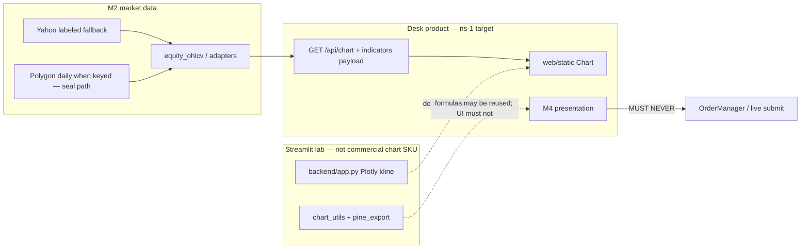

# 圖表／指標設計頁｜Charts & Indicators Design

> **Status:** Draft（ns-1 / charts-indicators）— 待 Owner／PM 審；**未 Accepted、未 merge 前唔作產品宣稱依據。Merge ≠ Accepted。**  
> **Binds under:** [ADR-003 + Addendum A](ADR-003-live-ai-trading-desk.md)（Accepted）> [MODULAR_ARCHITECTURE.md](MODULAR_ARCHITECTURE.md) > [AUDIT_REMEDIATION_PLAN_2026-10-21.md](AUDIT_REMEDIATION_PLAN_2026-10-21.md)（Confirmed items 1–5）> related Drafts：[BOUNDED_INTELLIGENCE_ACCEPTANCE.md](BOUNDED_INTELLIGENCE_ACCEPTANCE.md)（有界智能）／ [ACCOUNT_MANAGEMENT_DESIGN.md](ACCOUNT_MANAGEMENT_DESIGN.md)（管戶範圍）／ [LAB_PRODUCT_M7_BINDING.md](LAB_PRODUCT_M7_BINDING.md)（lab≠M7）。  
> **Index:** [ARCHITECTURE_DECISION.md](ARCHITECTURE_DECISION.md)。**ADR-002 is VOID.**  
> **North star（鎖定）：** 遠端交易台（TradingView-style 圖表／指標）；用戶可見可追溯日誌；參考訊號仍 planning；AI 幫管戶；迷你富途式 UX；**唔係**淨後台 Python 指標工具；真倉要過證據閘；Code Review 擋假 source／hardcode。  
> **Does not elevate:** Intent→M8／H1–H3、D7-DESIGN、Desk flatten product exception（G2）、fake verified／live、lab→`OrderManager`、產品 M7 實作已交付、參考訊號 schema 已定、真倉已就緒。Issue #10 stays OPEN.  
> **Does not rewrite:** ADR-003 body；live Harness config／strategy／rules；L2 憲法只經 Proposal→Approve→Merge。  
> **Date:** 2026-10-23（Asia/Hong_Kong）  
> **Baseline SHA:** `760bc0951e8f1abba9f9b4ed4f5cfe5809d52441`（`main`，含 plan-16 lab≠M7 PR #34）

---

## 1. 目的｜Purpose

用**一頁**鎖定北極星項 **ns-1**：遠端 Desk 上 **TradingView 式圖表／指標** 嘅產品範圍、現況誠實表、證據閘、同 v0 接受最小面。

本頁係**設計／接受頁**，唔係實作工單、唔係圖表庫選型已決、唔係「可上真倉」證書、唔係把 Streamlit Plotly 或 CSS sparkline 當已交付 TradingView 產品。

對齊缺口：ADR-003 北星同 MODULAR **M4** 寫「TradingView 式圖表／指標」；審計已指出前端 `web/` 仍薄。有界智能／管戶／lab≠M7 三頁唔寫圖表面。本頁補呢塊——**唔**擴大 2026-10-21 Confirmed remediation（Confirmed 維持 **1–5**；本頁**唔係** Confirmed item 6）。

---

## 2. 定義｜Definition

北極星原文精神：用戶可以**像 TradingView 咁睇圖、用指標**——可讀性（candles、overlays、pane indicators、timeframes、crosshair、legend），而唔係宣稱 TradingView 品牌／embed／授權已接入。

| 是（v0 設計範圍） | 不是 |
|-------------------|------|
| **TradingView-*style* 可讀性：** K 線、成交量、少量經典 overlay／副圖、時框、十字線、圖例 | 宣稱「TradingView integrated」、TradingView 官方 widget／帳號／social／Pine 市集、或已有授權 embed |
| **產品圖表落 FastAPI Desk + `web/static`**（ADR-003：Desk＝產品 UI） | 把 Streamlit Plotly／`backend/app.py` K 線當商業產品面，或復活 Streamlit 做收費圖表 SKU |
| 圖表＝**市場數據嘅衍生視圖**（OHLCV＋計算序列），帶 vendor／asof | 圖表指標＝已過風控訂單、`RISK_APPROVED`、broker fill、或 live 證明 |
| 指標值可 overlay／pane 展示；來源同公式可追溯 | 偽造／hardcode 序列；缺 bar 就填假 close；Yahoo fallback 當 paid verified bars |
| 參考訊號若日後 overlay：標 **planning**，有 sources | 本頁凍結 ADR-003 **D7** 參考訊號 schema；SignalCard 已定稿 |
| Streamlit 實驗室圖可保留研究 | Lab 指標／Pine export／pattern 確認＝產品已交付或可觸發 live 單 |

**接受陳述：** ns-1＝遠端 Desk 上、對用戶誠實嘅睇圖工具（數據來源可見、paper／live 唔混淆、指標唔當成交）。唔係「已經接咗 TradingView」，亦唔係 Python-only 後台指標玩具充當交易台。

---

## 3. 現況（對齊本 SHA，唔發明）｜Repo truth

本節係設計約束。**Baseline `760bc09` 上，Desk 沒有已交付嘅 TradingView 式圖表產品。** 有 Chart 導航同日線收盤 sparkline，唔等於北星已達。

| 面 | 現況（`760bc0951e8f1abba9f9b4ed4f5cfe5809d52441`） | 含義 |
|----|---------------------------------------------------|------|
| 產品 UI | Desk＝FastAPI + `web/static/index.html`；`web/src` React 係平行／遺留前端（`package.json` 只有 React／Vite，**無** chart 庫） | 產品圖表必須落 `web/static`（或日後正式 Desk 前端），唔把未上線 React 當已出貨 |
| Desk Chart 頁 | `web/static` `chart()`：`GET /api/chart/{symbol}` → 取 `bars[].c`，用 CSS `.bars`／`.bar` 畫最近約 80 根**收盤柱**；文案「Daily closes」 | **唔係** K 線；無 overlay、無 volume pane、無 RSI／MACD、無十字線、無 legend、無時框選擇 |
| Desk Chart API | `backend/api/app.py` `GET /api/chart/{symbol}`：直接 `yfinance.Ticker.history(period, interval="1d")`；payload `{symbol, bars:[{t,o,h,l,c,v}]}` | 日線 Yahoo-only；**無** `vendor`／`asof`／`fallback`；**未**走 `equity_ohlcv`（Polygon 優先） |
| `web/src` ChartPage | 同一 sparkline；caption「Daily closes · Yahoo. Full drawing tools can come later.」 | 誠實自我標註：繪圖工具未做；唔當產品完成 |
| Streamlit lab | `backend/app.py` `_build_tech_chart`／`_render_kline_chart`：Plotly **Candlestick**＋Volume；日線可加 SMA20／EMA20／SMA50／BB／RSI／MACD；時框 `1d`／`60m`／`15m`／`1m`；pattern／trade-plan 層；Pine 下載 | **lab／legacy**；能力較近北星可讀性，但**唔係** Desk 產品面 |
| `chart_utils` | `backend/utils/chart_utils.py`：`st.cache_data`；Yahoo → Alpha Vantage 日線 → Yahoo HTTP | **綁 Streamlit**；唔係 Desk API 路徑 |
| M2 付費 bars | `backend/utils/equity_ohlcv.py`：有 key 時 Polygon daily 優先，Yahoo **labeled fallback**；worker／Scan technicals／backtest／seal 路徑用 | 付費 bars 喺 **seal／paper worker** 敘事（見 [PAID_DATA_PIT_PLAN.md](PAID_DATA_PIT_PLAN.md)）；**Desk chart API 未對齊** |
| 指標計算（非圖） | `technical_analyzer.py`：RSI／MACD／SMA／EMA／BB／ATR 等餵 **Scan 分數**；worker 策略可喺 OHLCV 加欄 | 研究／策略衍生；**未**做 Desk overlay API |
| TradingView 品牌 | Streamlit 有 `chart.download_pine`（`backend/pine_export.py` 研究計劃 → Pine 文字檔） | **匯出草稿** ≠ TradingView 整合／授權／embed |
| MODULAR M4 | Owns：`chart_utils`、`GET /api/chart`、前端「**部分已有／需加強**」；`web/src/features/chart` **TBD**；MUST NEVER：指標當已過風控單、偽造數值 | 文件已承認未達 TV 體驗；本頁唔把 TBD 寫成已交付 |
| 前端厚度 | 審計：「前端 `web/` 仍薄」；README 產品段強調 Scan／Deep／Auto／journal，**未**宣稱 TV 圖表已上線 | 同 repo 一致：Chart 頁存在 ≠ 北星圖表 |

**誠實一句：** 而家用戶喺遠端 Desk 見到嘅係 Yahoo 日線收盤柱狀圖；完整 K 線＋指標只喺 Streamlit 實驗室。ns-1 要設計嘅係前者升級，而唔係宣布後者已係產品。

---

## 4. Scope — Desk vs lab｜產品圖表落邊

產品圖表**先**落 FastAPI Desk + `web/static`。Streamlit 維持 lab／legacy。**禁止**把 Streamlit 復活成商業圖表面。

| 關注點 | Desk（產品） | Streamlit（lab／legacy） |
|--------|--------------|--------------------------|
| **誰出貨** | 遠端交易台 Chart 頁 | 研究／舊 UI；可保留，唔餵「已有 TV 圖表」文案 |
| **渲染** | 目標：candles＋volume＋閉合指標集（§7）；而家＝收盤 sparkline | 已有 Plotly K 線＋多 pane；**唔**當 Desk 完成證明 |
| **數據** | 應對齊 M2 vendor／asof；Yahoo fallback **必須標** | `chart_utils` 多源但 Streamlit-coupled；唔自動變 Desk 來源 |
| **指標** | 展示用衍生視圖；唔觸發訂單 | 同一：lab 指標／pattern／Pine **禁止**接 `OrderManager` |
| **期權／黃金** | 期權鏈 overlay、黃金圖＝**之後**（§8 GC 表）；v0 美股現貨／ETF 日線為主 | 唔升格為產品期權圖／黃金 SKU |

Worker／lab 指標（策略欄、Scan RSI、Plotly MACD）**唔准靜默變成 live 觸發器**。落單只經 Mandate→Risk→`OrderManager`（Desk 手動）或 worker 錢路徑；圖表點擊／指標交叉**唔係** M9 入口。

---

## 5. 證據閘｜Evidence gates（圖表唔 stamp verified／live）

對齊 ADR-003 §4 C／D4、有界智能頁 §7、管戶頁 §5。圖表 UI／API **永遠**唔准用「有 K 線／有指標／有 Yahoo 柱」去 stamp `verified: true`／`live: true`。

| 閘 | 圖表含義 | 失敗必須看起來失敗 |
|----|----------|--------------------|
| Paper ≠ live | Desk 頂欄 PAPER；圖表唔顯示 Live ready／真倉徽章 | 紙倉圖 ≠ 真倉已就緒 |
| Filled-only | 成交標記只畫 **recorded fill** | 未成交 limit、shadow 估價、KPI 空倉唔當 fill 標記 |
| Missing bars ≠ filled evidence | 缺 bar／空 history＝404 或明確 empty；**禁止**插值假 close 當完整序列 | 空白唔扮有數據 |
| Indicator ≠ broker fill | RSI／MACD／均線係**計算視圖** | 指標交叉唔寫 `FILLED`／`RISK_APPROVED` |
| Vendor honesty | payload 標 `vendor`／`asof`／`fallback`；Yahoo 就寫 Yahoo | 唔把 Yahoo 標成 Polygon／paid verified |
| Seal path ≠ chart path | 付費 daily bars 用喺 worker／seal（有 key 時）；Desk 圖未對齊前要講明 | 睇到圖 ≠ seal 已過 |
| M13 | 無假 source／hardcode 序列／假 summary 餵 scan／Proposal／其他 worker | PR 拒收 |
| 參考訊號 | overlay 若有，標 planning＋sources | 唔凍結 D7 schema；無 sources 就唔畫「已核實訊號」 |

**明文：** 未成交 limit ≠ 證據。缺 bar ≠ 已填證據。Sparkline／Plotly 截圖 ≠ TradingView 已整合。Paper 圖 ≠ live。

---

## 6. 數據／指標邊界｜Data vs overlay vs signal markers

三層必須分開；混層＝假產品。

| 層 | 係咩 | 可以 | 禁止 |
|----|------|------|------|
| **A. 市場數據** | OHLCV／volume；M2 ingress | 標 vendor、asof、interval、fallback | Hardcode 報價；把 fallback 當 paid verified；24h／非美股日曆 bar 當 NYSE 日線而不標 |
| **B. 策略／經典 overlay** | SMA／EMA／BB／RSI／MACD 等**衍生序列** | Desk 展示；公式／參數可見 | 交叉／超買超賣單獨下單；當 M8 已批 |
| **C. 參考訊號標記** | 建議買／賣、策略說明、指標解讀（ADR-003 **D7 still planning**） | 若露出：planning 標＋sources＋journal 可溯 | 本頁定稿 SignalCard schema；無來源標記當已核實 Intent |

Worker 策略加喺 DataFrame 嘅欄、Scan `technical_analyzer` 分數、lab debate memo：**唔係** C 層已交付，亦**唔係** live 觸發。產品 M7（`backend/trading/advisory/`，仍 OPEN）若日後產 veto／tier，可做註解層，**唔寫**訂單（見 [LAB_PRODUCT_M7_BINDING.md](LAB_PRODUCT_M7_BINDING.md)）。

Intent→M8／H1–H3 **仍 OPEN**；圖表頁**唔**變成 Intent writer 或 M8 sizer。

---

## 7. v0 接受最小面｜UX minimum（proposed, Draft）

以下係 **Draft 建議**，Owner／PM Accepted 之前**未鎖**。達標先可稱「Desk 有 TradingView *式* 基本圖」；未達標只可講「Chart 頁有收盤柱／實驗室有 Plotly」。

| v0 建議有 | v0 明確唔做 |
|-----------|-------------|
| 符號＋時框（至少 **日線**；盤中時框另決 GC2）K 線 | 完整 TradingView clone（繪圖工具全集、社群、報價板、多屏 workspace） |
| Volume pane | Broker 圖表同步當 **live 證明** |
| 閉合經典集（建議）：overlay SMA20／SMA50／EMA20／BB；pane RSI(14)、MACD(12,26,9) | 開放式用戶腳本市集、任意 Pine 執行引擎 |
| 十字線＋legend＋可見時間／OHLC | 期權鏈 overlay（later，GC3）；黃金／商品圖 SKU（later，GC4） |
| 數據 provenance：vendor／asof／fallback；Yahoo 必須可見 | 把 lab Pine 下載當「已接 TradingView」 |
| 頂欄 PAPER 語意不變 | Stamp verified／live；用圖表當 seal 通過 |

**非目標（本頁）：** 社交、跟單、TradingView 帳號登入、官方 embed 授權採購（若日後要 embed，另開 Owner 決策＋採購，唔由本 Draft 批准）。

---

## 8. 開放決策（要 Gabriel 拍板）｜Open decisions（G-table）

本頁 **Draft** 只建議預設；**全部未鎖**。Accepted 之前唔寫進 runtime／Harness。

| ID | 問題 | 建議預設（未鎖） | 若另決會影響 |
|----|------|------------------|--------------|
| **GC1** | Desk 圖表庫：`lightweight-charts` vs Plotly.js vs 其他 vs 官方 TradingView widget | **先 lightweight-charts（Apache-2.0 風格可讀 K 線）**；**唔**默認官方 widget（品牌／授權／social 負擔）。Streamlit 可繼續 Plotly | 前端依賴、M4 組件、唔把 lab Plotly 直接搬 Desk |
| **GC2** | 即時推送 vs 快照拉 bar | **v0 快照**（日線 REST）；websocket／盤中即時另決 | API、VPS 負載、vendor 級別（delayed ≠ realtime） |
| **GC3** | 期權鏈／希臘字母 overlay | **Later**；v0 美股／ETF 現貨圖 | 同管戶頁 G4：期權研究-only |
| **GC4** | 黃金／商品圖 | **Later**；現有 `defensive_gld` 仍係策略旗，唔係圖表 SKU | 同管戶頁 G5 |
| **GC5** | 可唔可以「把 Streamlit Plotly 嵌進 Desk」當 ns-1 交付？ | **唔可以**當產品交付；公式可重用，UI 必須 Desk-native | 防止 lab＝產品 |
| **GC6** | Desk `/api/chart` 要唔要改走 `equity_ohlcv`（Polygon 優先、Yahoo 標 fallback）？ | **建議對齊 M2 標籤**；未改之前文案必須講 Yahoo。對齊 ≠ 宣稱 paid realtime／verified | 同 PAID_DATA_PIT；無 key 時仍 Yahoo fallback |
| **GC7** | v0 閉合指標集係咪 §7 嗰組？ | **建議係**；加碼＝新 PR＋本表更新；禁止開放字串指標當「系統內建核實」 | M4 payload schema |

---

## 9. Draft vs still OPEN｜本頁合入後（docs only）

**Code／圖表產品唔因本頁變完成。** Status：**Draft** pending Owner／PM；**未 Accepted。Merge ≠ Accepted。** 未 Accepted、未 merge 前唔作產品宣稱依據。Confirmed remediation 仍係 **1–5 only**。

| ID | Status | Notes |
|----|--------|-------|
| **本設計頁** `docs/CHARTS_INDICATORS_DESIGN.md` | **Draft**（pending Owner／PM; **not yet Accepted**） | Merge ≠ Accepted；唔升格 M4 實作／D7 schema |
| 有界智能接受頁 | Draft（plan-14） | 接受條件；本頁專寫圖表面 |
| 管戶設計頁 | Draft（plan-15） | Desk vs worker 帳戶；本頁唔取代 |
| lab≠M7 綁定頁 | Draft（plan-16） | lab 唔接 OrderManager；lab 圖同樣唔接 |
| Desk TradingView-style 圖表產品 | **OPEN（未交付）** | 現況＝收盤 sparkline |
| Streamlit Plotly K 線 | lab 既有；**唔係**產品交付 | 維持 lab／legacy |
| 參考訊號 schema（ADR-003 D7） | **planning／OPEN** | 本頁唔定稿 |
| Intent→M8／H1–H3／完整 M8 StrategyBase | **OPEN** | 唔由本頁排期 |
| D7-DESIGN | **OPEN** | 雙目錄未合併（同名刀 ≠ 參考訊號 D7） |
| Desk flatten product exception（G2） | **OPEN** | 唔升格 |
| Fake verified／live | **OPEN** | 本頁只綁「圖表唔准 stamp」 |
| 產品 M7 `backend/trading/advisory/` | **OPEN（未交付）** | 唔由本頁實作 |
| AUDIT Confirmed remediation | **1–5 only** | **唔**加 item 6 |
| **Issue #10** | **OPEN** | Parent audit inventory remains OPEN |

---

## 10. 不得宣稱｜Must not claim

未 Accepted／未過對應閘之前，產品／文件／銷售／UI **禁止**宣稱或暗示：

1. **可上真倉／live ready／verified**（有圖 ≠ 真倉）。  
2. **「TradingView integrated／已接入 TradingView」** 或已有官方 embed／授權。  
3. **Desk 圖表產品已交付**（sparkline ≠ TV 式 K 線＋指標）。  
4. **參考訊號／SignalCard schema 已定稿**（D7 仍 planning）。  
5. **Intent→M8／D7-DESIGN／Desk flatten／產品 M7／issue 10 庫存已完成。**  
6. **Lab Plotly／Pine export = 產品圖表**，或 lab 指標已接到 `OrderManager`。  
7. **指標交叉／缺 bar 填補／未成交 limit = 實盤證據。**  
8. **本 Draft 合入＝Accepted 憲法**（Accepted 之後先升格；仍唔改 runtime）。**Merge ≠ Accepted。**  
9. **ADR-002 仍有效**（VOID）。

---

## 11. Out of scope this page｜本頁／本週期唔做

- 改 runtime／Harness config／strategy／rules；實作圖表庫、改 `GET /api/chart`、搬 Plotly 入 Desk。  
- 實作 Intent→M8、D7-DESIGN、Desk flatten、產品 M7。  
- Stamp verified／live；凍結參考訊號 schema。  
- 擴大 2026-10-21 Confirmed remediation（**保持 1–5**；本頁**唔係** item 6）。  
- 改寫 ADR-003 正文。復活 **ADR-002**。  
- 完整 TradingView clone；社交；broker 圖同步當 live 證明；期權執行圖；黃金 SKU。  
- Issue #10 stays OPEN（父審計庫存繼續開；本頁唔當庫存完成）。

---

## 12. 同其他文件關係｜Authority

衝突時（本頁最低，直至 Owner Accept）：

1. **ADR-003 + Addendum A**（決策＋北星＋§4 驗收＋Proposal 治理）  
2. **MODULAR_ARCHITECTURE**（M2／M4／M5／M11；圖表 MUST NEVER）  
3. **AUDIT_REMEDIATION_PLAN**（Confirmed items 1–5；P0 journal 先）  
4. **BOUNDED_INTELLIGENCE_ACCEPTANCE**（AI 能力切片接受條件）  
5. **ACCOUNT_MANAGEMENT_DESIGN**（管戶產品範圍）  
6. **LAB_PRODUCT_M7_BINDING**（lab≠M7；lab 圖唔接執行）  
7. **本頁**（ns-1 圖表／指標產品範圍；Owner 接受後）  
8. 舊 roadmap／runbook（frozen；**ADR-002 is VOID**）

本頁**不改變** live RiskEngine／Kelly／mandate／kill 設定或交易 runtime。

---

*Drafted 2026-10-23 for ns-1 charts/indicators design page. Owner／PM 審批前維持 Draft。Merge ≠ Accepted. Issue #10 stays OPEN.*
