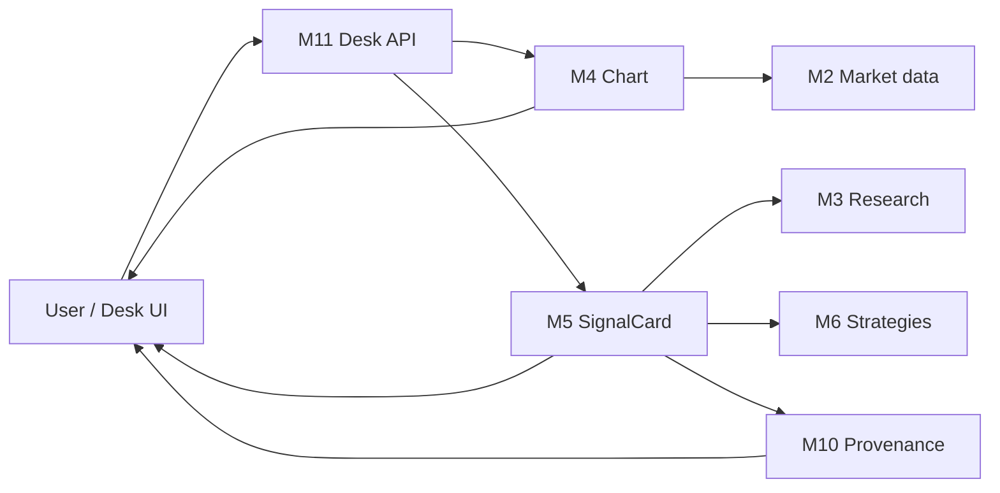
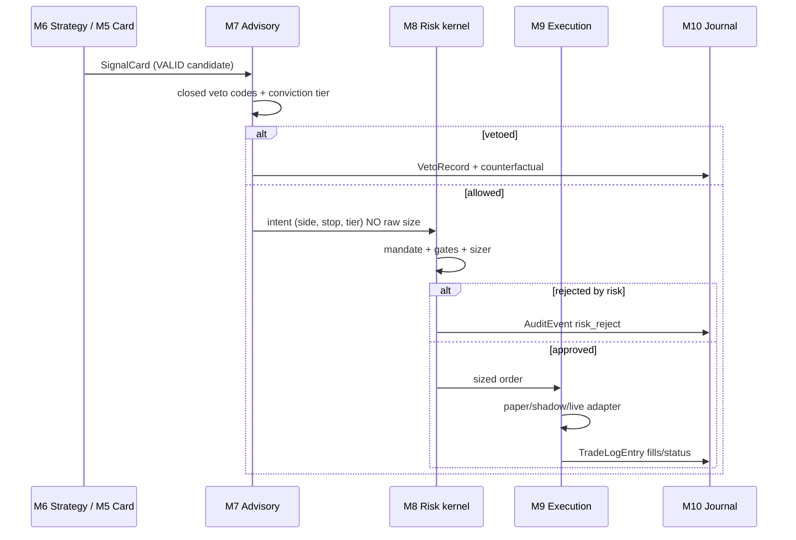
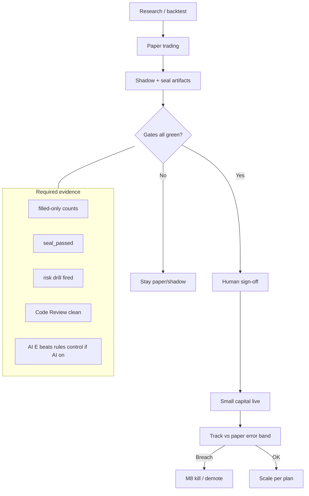
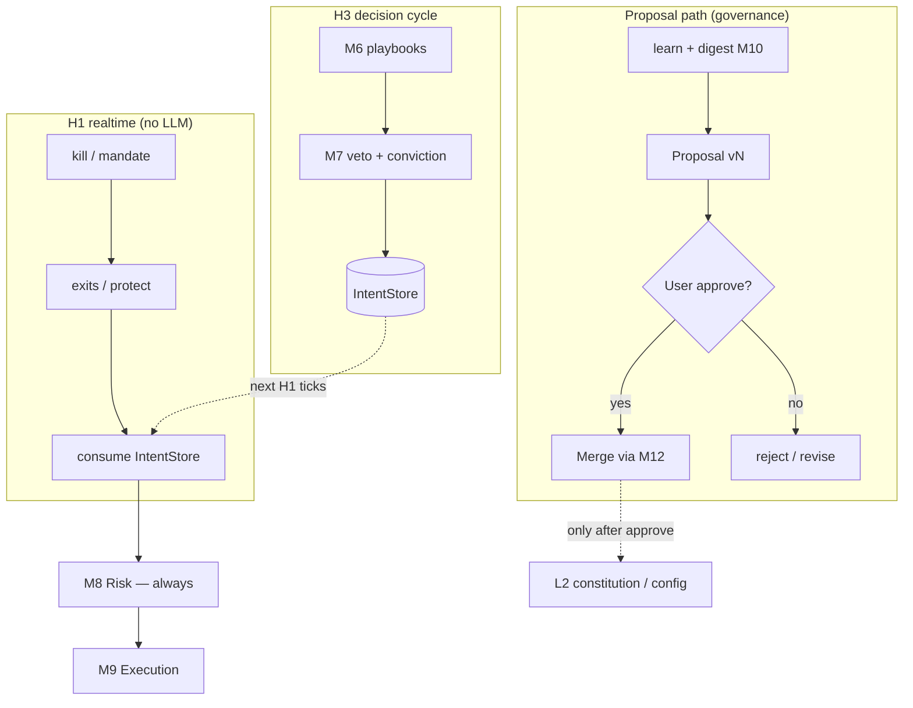
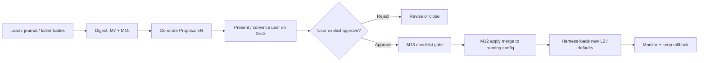

# MODULAR_ARCHITECTURE — 版塊式系統架構（建庫前）

> **Binds under ADR-003 + Addendum A (Accepted).** Index: [`ARCHITECTURE_DECISION.md`](ARCHITECTURE_DECISION.md). Canonical ADR: [`ADR-003-live-ai-trading-desk.md`](ADR-003-live-ai-trading-desk.md). Audit: [`AUDIT_REMEDIATION_PLAN_2026-10-21.md`](AUDIT_REMEDIATION_PLAN_2026-10-21.md) (**Confirmed by Gabriel 2026-10-21**). **ADR-002 is VOID.** Product UI = FastAPI Desk (`web/static`); Streamlit = lab/legacy. `backend/lab/advisory_debate.py` **≠ product M7** and must **not** wire to `OrderManager`.

**Status:** Draft for build planning（對齊 ADR-003 Accepted）  
**Date:** 2026-10-21  
**Authority:** ADR-003 Accepted（2026-10-21 by Gabriel in chat）  
**Language:** 中文為主；模組 ID／路徑用英文  
**Repo root:** `C:\Users\001\cgabrielck-stock-analyzer`

## 視覺架構圖

- **[boomboom-modular-architecture.html](boomboom-modular-architecture.html)** — dark-themed interactive SVG（M1–M13 DAG、Copy / PNG / PDF）
- 對齊本文件 §2 Block map；硬規則：AI 唔能繞過 M8；LLM／TG 唔落單

> ADR-002 為 VOID，本文件**唔引用**佢作約束。工程偏好「演進現有 `backend/trading/`」來自 ADR-003 D5 同本規劃，唔係舊 ADR 繼承。

---

## 1. Goals / Non-goals

### 1.1 Goals｜目標

1. **遠端交易台（Desk）：** 用戶可遠端操作 console，體驗接近迷你富途，但更易讀。
2. **TradingView 式圖表／指標：** 睇圖、用指標；唔係淨後台腳本。
3. **可追溯交易日誌：** 每筆由訊號→風控→下單→成交／拒絕，用戶可見、可點開溯源。
4. **參考交易訊號（Reference signals）：** 建議買入／賣出、指標解讀、策略說明——**schema 仍 planning**，但必須有版本化卡片形狀同來源欄位。
5. **AI 管戶輔助：** 股票／期權；之後可加黃金。AI = 閉合 veto + conviction tier；**唔准**傳 raw size、唔准繞風控。
6. **真倉證據閘：** paper／shadow 晉升；filled-only；seal；人簽；小倉先行。
7. **建設支柱：** VPS、Market data API、User App、Code Review 紀律。
8. **可維護版塊：** 模組邊界清晰、依賴 DAG、合約版本化，方便之後加／換版塊而唔拆内核。
9. **用戶治理自我升級：** Harness 可從失敗單／journal 學習並產出 **Proposal（完整更新版本）**；**僅在用戶明確批准後**先 merge 入運行中 config／策略／規則。唔准靜默改 L2 憲法（mandate／kill／風險上限／live 旗標）。

### 1.2 Non-goals｜非目標（本階段唔做）

- 保證盈利或「永遠可上真倉」。
- 完整參考訊號／策略 schema 定稿（仍 planning；只定最小可演進合約）。
- 黃金／商品完整實作（只預留 M2／M5 擴展點）。
- 多 Agent 辯論委員會做**主執行引擎**。
- LLM／Telegram／聊天渠道**直接下單**。
- Greenfield 整庫重寫（除非 Owner 另決）。
- 以假 source／hardcoded 結論餵其他 worker。
- Harness／AI **靜默 full-access** 自動改寫 mandate／kill／風險％／live 旗標（憲法 L2）——升級必須走 Proposal → Approve → Merge。

---

## 2. Block map｜版塊總覽（M1–M13）

依賴規則：**只准箭頭方向依賴**（DAG）；禁止環。低號基礎設施可被高號消費；**M8 唔依賴 M7**（風控唔讀 LLM 意見做硬閘）。

| ID | 模組名 | 一句責任 | 可依賴 |
|----|--------|----------|--------|
| **M1** | Identity & accounts | 用戶／帳戶身份、session、多帳戶模型 | （無業務依賴；可讀 config） |
| **M2** | Market data ingress | 行情／K 線／期權鏈接入；Yahoo fallback／付費 bars；預留黃金 | config、cache util |
| **M3** | Research & scoring | 基本面／技術／風險調整評分 DNA、scan／deep | M2 |
| **M4** | Chart & indicator presentation | TradingView 式圖表／指標渲染與指標計算輸出給 UI | M2（OHLCV）；可讀 M3 註解層 |
| **M5** | Reference signal service | 版本化 SignalCard（買／賣建議、指標、策略——schema planning） | M2、M3、M6（讀）；**唔寫**訂單 |
| **M6** | Strategy playbooks | 具名策略（stable／aggressive／…）產出 VALID／skip | M2、M3 |
| **M7** | AI advisory | 閉合 veto + conviction；解讀／摘要；**learn／digest 輔助產 Proposal**；**唔下單** | M5／M6、M2、M10（讀 journal）；**唔依賴** M9 落單；**唔直寫** L2 |
| **M8** | Risk & safety kernel **PROTECTED** | gates、sizer、mandate、kill、audit；fail-closed | M1（帳戶限額上下文）；**唔依賴** M7 |
| **M9** | Execution & broker adapters | paper／shadow／live（gated）下單與成交 | M8（必須）、broker SDK；可讀 M6 訊號經 processor |
| **M10** | Trade journal & provenance | 用戶可見交易／訊號溯源日誌 | 讀 M5–M9 事件；寫 journal／audit 視圖 |
| **M11** | Desk App / API | FastAPI + web 遠端 UI | M1–M10 之**公開 API**；唔直改 M8 內部 |
| **M12** | Ops（VPS／worker／heartbeat／TG ops） | 進程、心跳、部署、營運通知；**TG 唔落單** | M9 worker、M8 kill／ops；M11 控制面 |
| **M13** | Code Review & quality gates | CI／審查規則：擋 fake source、hardcode、繞風控 | 全庫（只讀／閘門）；唔係 runtime 交易路徑 |

### 2.1 DAG（文字）

```
M1 ──┐
M2 ──┼──► M3 ──► M6 ──► M5 ──► M7
 │   │         │         │
 │   └──► M4 ◄─┘         │
 │                       ▼
 │              M8 (PROTECTED) ◄── M1
 │                       │
 │                       ▼
 │                      M9 ──► M10
 │                       │
 └──► M11 ◄──────────────┴── M12
              M13 ──(gates all)──► *
```

---

## 3. Per-block detail｜各版塊細則

路徑以 2026-10-21 倉庫實樹為準；未存在標 **TBD／新建**。

---

### M1 — Identity & accounts

| 項 | 內容 |
|----|------|
| **Purpose** | 帳戶模型、session、desk 認證；為風控／執行提供 account context |
| **Owns（現有）** | `backend/accounts/`（`factory.py`, `models.py`, `repository.py`, `session.py`）；`backend/persistence/migrations/001_accounts.sql` 等；`backend/api/desk_auth.py` |
| **Public interfaces** | Account CRUD／session；desk auth middleware；`GET /api/account`（經 M11） |
| **Writes** | 帳戶／session 持久化（DB／repo）；**唔寫**訂單 |
| **MUST NEVER** | 繞過 M8 改曝險；把 broker key 暴露去前端 |
| **Tests** | `tests/test_accounts.py`, `test_account_i18n.py`, `test_account_repository_errors.py` |
| **Evolution** | 多帳戶／紙倉 vs 真倉旗標；遠端登入強化（TBD） |

---

### M2 — Market data ingress

| 項 | 內容 |
|----|------|
| **Purpose** | 統一行情入口：股票 OHLCV、報價、期權；標記 vendor；Yahoo = fallback |
| **Owns（現有）** | `backend/agents/data_fetcher.py`, `polygon_equity.py`, `polygon_options.py`, `alpha_vantage_data.py`, `cboe_options.py`, `tradier_options.py`, `marketdata_options.py`, `options_quote_adapter.py`, `china_data_fetcher.py`；`backend/utils/equity_ohlcv.py`, `price_utils.py`, `cache.py`, `us_equity_calendar.py`；`backend/trading/engine/fetch_policy.py` |
| **Public interfaces** | `get_ohlcv(symbol, …)`, quote batch、options chain adapters；provenance 標籤（vendor／asof） |
| **Writes** | `backend/data/cache/`；唔寫交易決策 |
| **MUST NEVER** | 靜默用過期／無 vendor 數據當「已驗證 paid bars」；硬編碼假報價當 source |
| **Tests** | `tests/test_data_fetcher.py`, `test_polygon_*.py`, `test_equity_ohlcv.py`, `test_options_*`, `test_cboe_options.py`, `test_alpha_vantage_data.py` |
| **Evolution** | 付費 bars 作 seal／paper 主路徑（見 `docs/PAID_DATA_PIT_PLAN.md`）；**黃金／商品：TBD adapter** |

---

### M3 — Research & scoring

| 項 | 內容 |
|----|------|
| **Purpose** | 研究掃描、深研、風險調整評分 DNA；產出 scan／deep 產物畀策略同 UI |
| **Owns（現有）** | `backend/agents/fundamental_analyzer.py`, `technical_analyzer.py`, `risk_analyzer.py`, `recommender.py`, `score_contract.py`, `signal_pillars.py`, `pattern_analyzer.py`, `deep_research.py`, `sec_analyzer.py`, `sentiment_analyzer.py`, `market_regime.py`, `portfolio_manager.py`, `picks_news.py`；`backend/research/*`；`backend/api/research_jobs.py`, `scan_scheduler.py`；產物 `backend/data/last_scan.json`, `last_deep.json` |
| **Public interfaces** | scan／deep job API；`fund_score_from_row`／quality fields（`score_contract`）；research by symbol |
| **Writes** | `last_scan.json`, `last_deep.json`, agent_state* |
| **MUST NEVER** | 直接下單；把 LLM 散文當已核實 fundamental 數字（要 provenance） |
| **Tests** | `tests/test_fundamental_analyzer.py`, `test_recommender.py`, `test_deep_research.py`, `test_risk_analyzer.py`, `tests/research/*` |
| **Evolution** | 同 M5 對接時輸出「可引用欄位」而非無來源摘要 |

---

### M4 — Chart & indicator presentation

| 項 | 內容 |
|----|------|
| **Purpose** | TradingView 式圖表：OHLCV＋指標序列＋前端渲染 |
| **Owns（現有）** | `backend/utils/chart_utils.py`；`GET /api/chart/{symbol}`（`backend/api/app.py`）；前端 `web/src/*`, `web/static/index.html`（圖表能力**部分已有／需加強**） |
| **Public interfaces** | Chart payload：candles、indicators[]、overlays TBD；前端 chart component（**TBD 強化至 TV 體驗**） |
| **Writes** | 原則上無持久交易狀態；可 cache 衍生指標 |
| **MUST NEVER** | 把圖表指標信號直接當已過風控嘅訂單；偽造 indicator 數值 |
| **Tests** | `tests/test_chart_utils.py`；前端測試 **TBD** |
| **Evolution** | P1：指標面板、多時框、同 SignalCard overlay；P2：用戶自選指標組合 |

---

### M5 — Reference signal service

| 項 | 內容 |
|----|------|
| **Purpose** | 產出**用戶可見**參考訊號卡（買／賣建議、指標解讀、策略）——**schema still planning** |
| **Owns（現有／缺口）** | 現有分散：`backend/agents/recommender.py`, `trading_strategies.py`, `signal_pillars.py`；**尚無**獨立 `signals/` 版塊 → **新建建議：** `backend/signals/`（TBD） |
| **Public interfaces** | `SignalCard` v0（見 §5）；`GET/POST` signals API（TBD via M11）；版本欄位 `schema_version` |
| **Writes** | `backend/data/signals/` 或 DB（TBD）；每卡必須 `sources[]` |
| **MUST NEVER** | 無 source 嘅結論；hardcoded「必買」摘要餵 M7／worker；自行呼叫 M9 下單 |
| **Tests** | TBD：`tests/signals/` — schema 驗證、source 必填、版本相容 |
| **Evolution** | Owner 定稿 schema 前，UI 標「規劃中」；只擴欄位、唔偷改語意 |

---

### M6 — Strategy playbooks

| 項 | 內容 |
|----|------|
| **Purpose** | 具名策略：VALID／skip_codes、入場結構；可並存多策略 |
| **Owns（現有）** | `backend/trading/strategies/`（`base.py`, `registry.py`, `stable.py`, `aggressive.py`, `trend.py`, `adaptive.py`, `stage2.py`, `research_list.py`, `defensive_gld.py`, `skip_codes.py`） |
| **Public interfaces** | Strategy registry；evaluate(symbol, ctx) → signal／skip；worker 選策略名；H3 `upsert_active_intent`（`backend/trading/intents/writer.py`）寫 IntentStore |
| **Writes** | 策略評估日誌（可入 journal）；唔直接下單 |
| **MUST NEVER** | 靜默改名頂替另一策略行為；跳過 M8 |
| **Tests** | `tests/trading/strategies/*`；IntentStore：`tests/trading/intents/*` |
| **Evolution** | 新策略＝新檔＋registry；「買 Scan 名單」必須獨立策略名 |

---

### M7 — AI advisory

| 項 | 內容 |
|----|------|
| **Purpose** | 有界智能：閉合 veto、conviction、解讀；**learn／digest 輔助**產出治理用 Proposal；**唔下單** |
| **Owns（現有）** | 多為 TBD：`backend/trading/advisory/`（建議新建）；可暫掛 `backend/utils/` 適配器；**禁止**放喺可直呼 broker 之處 |
| **Public interfaces** | `evaluate(card) -> {veto_codes[], conviction_tier, notes}`；`digest_for_proposal(journal_slice) -> HarnessProposal draft`；輸出 `VetoRecord` |
| **Writes** | veto／advisory audit（經 M10）；**Proposal draft**（未批准）；**唔寫** orders；**唔直寫** L2 |
| **MUST NEVER** | `place_order`；傳 raw qty／notional 當最終倉；開放式 veto；因 headline **單獨**觸發買入；**靜默 merge L2**；阻塞 H1 loop；把 `backend/lab/advisory_debate.py` 當成產品 M7 或接到 M9 `OrderManager` |
| **Tests** | 單元：未知 code 唔攔；開放式 veto 拒收；Proposal 無 Approve 唔 apply；同規則對照夾具（E 測試屬 P2） |
| **Evolution** | 閉合清單配置化；journal→**Proposal（人批）**；自動改 mandate／kill／風險％ **禁止** |


---

### M8 — Risk & safety kernel（PROTECTED）

| 項 | 內容 |
|----|------|
| **Purpose** | Fail-closed 風控：limits、sizing、mandate、kill、audit |
| **Owns（現有）** | `backend/trading/risk/gates.py`, `position_sizer.py`；`backend/trading/safety/mandate.py`, `kill_switch.py`, `audit.py` |
| **Public interfaces** | `RiskEngine.evaluate(...)` → `RiskDecision`；sizer(equity, risk_pct, stop) → qty；mandate check；kill／resume；audit append |
| **Writes** | `backend/data/audit/audit_YYYY-MM-DD.jsonl`；kill／mandate 狀態檔（依實作） |
| **MUST NEVER** | 依賴 M7／LLM 放行；接受模型傳入 raw size；被 UI／TG 靜默關閉而無 audit |
| **Tests** | `tests/trading/risk/*`, `tests/trading/safety/*` — **改語意＝最高審查** |
| **Evolution** | 只允許加硬規則／收緊；放寬必須 Owner 書面＋破壞測試 |

**Protected 變更：** 獨立 ADR／Owner 簽名；M13 必拒「為 AI 打開後門」類 PR。

---

### M9 — Execution & broker adapters

| 項 | 內容 |
|----|------|
| **Purpose** | 訊號經 processor → 風控後下單；paper／shadow／live |
| **Owns（現有）** | `backend/trading/engine/signal_processor.py`, `order_manager.py`, `shadow.py`, `worker.py`, `cadence.py`, `harness_realtime.py`（H1 consume hook；完整 H1/H2 拆分 TODO）；`backend/trading/broker.py`, `alpaca_broker.py`；`backend/trading/models.py`, `storage.py`；`backend/trading/reconciliation/service.py`；`backend/trading/performance/tracker.py`；數據 `shadow_orders.*`, `trading_orders.sqlite3`, `performance_*.json` |
| **Public interfaces** | Worker tick；submit／cancel order（經 M8）；shadow fill；broker adapter |
| **Writes** | orders／fills／positions／shadow／performance |
| **MUST NEVER** | 接受未過 M8 嘅訂單；`--allow-live` 未過晉升閘；聊天渠道落單 |
| **Tests** | `tests/trading/engine/*`, `performance/*`, `reconciliation/*` |
| **Evolution** | Live 路徑嚴格 gated；broker 可換 adapter，唔改 M8 語意 |

---

### M10 — Trade journal & provenance

| 項 | 內容 |
|----|------|
| **Purpose** | 用戶可見、可追溯：訊號來源、veto、風控決定、訂單生命周期；**失敗單證據餵 Proposal digest** |
| **Owns（現有）** | `backend/utils/provenance/`；`backend/api/provenance.py`；`GET/POST /api/journal`；根目錄 `TRADE_JOURNAL.md`；audit jsonl（與 M8 共享讀） |
| **Public interfaces** | Journal API；provenance 附加喺 scan／signal／order 響應；Desk「交易日誌」視圖 |
| **Writes** | journal entries；可物化 `TradeLogEntry`（§5） |
| **MUST NEVER** | 刪改歷史而無 audit；對用戶隱藏拒絕原因 |
| **Tests** | `tests/utils/provenance/*`；journal API 測試 TBD |
| **Evolution** | P0–P1：統一 TradeLogEntry；前端時間線 UI |

---

### M11 — Desk App / API

| 項 | 內容 |
|----|------|
| **Purpose** | 遠端用戶面：FastAPI desk + web（圖表、訊號、日誌、ops） |
| **Owns（現有）** | `backend/api/app.py`（主路由）, `desk_auth.py`, `desk_digest.py`, `paper_performance.py`, `worker_ctl.py`, `provenance.py`, …；`web/src/App.tsx`, `api.ts`, `web/static/`；`backend/trading/ui/`（monitor／dashboard——偏 lab）；`backend/static/` |
| **Public interfaces** | 見現有 `/api/*`：account、positions、orders、chart、scan、deep、journal、ops、worker、performance、lab、`/api/intents`（L1 IntentStore；local／unverified）…；**新增 TBD：** `/api/signals`, 增強 chart indicators |
| **Writes** | 經服務層；UI 唔直寫 sqlite |
| **MUST NEVER** | 前端計算倉位繞 M8；暴露 secrets；用 TG 當下單 UI |
| **Tests** | API 層測試分散於 `tests/test_app_state.py` 等；E2E **TBD** |
| **Evolution** | P1 對齊北極星：圖表＋訊號卡＋日誌時間線；Streamlit（若仍存在）＝lab，唔係主商業面 |

---

### M12 — Ops：VPS、worker、heartbeat、Telegram ops

| 項 | 內容 |
|----|------|
| **Purpose** | 遠端常駐、健康、營運告警；**唔係**交易決策通道 |
| **Owns（現有）** | `backend/trading/engine/worker.py`；`backend/data/worker.pid`, `worker_heartbeat.json`, `worker.log`；`backend/trading/ops_notifier.py`, `telegram_inbox.py`；`deploy/alphadesk-worker.service`, `deploy/README.md`；`railway.toml` |
| **Public interfaces** | worker start／stop／status API；kill／resume ops；heartbeat 檔；TG **通知／只讀指令白名單**（若有） |
| **Writes** | heartbeat、logs、ops 通知 |
| **MUST NEVER** | Telegram／聊天 **place_order**；無認證公開 kill |
| **Tests** | worker／ops 相關測試；deploy dry-run checklist |
| **Evolution** | VPS 安裝手冊；監控面板；告警分級；**Approve 後 apply／rollback Proposal（L2）**；拆 H1 realtime vs H3 decision worker |

---

### M13 — Code Review & quality gates

| 項 | 內容 |
|----|------|
| **Purpose** | 自動／半自動擋：hardcoded 結論、假 source／假 summary、繞 M8、未過晉升就 live；**審 Proposal checklist** |
| **Owns（現有）** | `docs/CITATION_REFUSALS.md`, `QUALITY_ROADMAP.md`, `LAB_CITATION_TRY.md`；`.cursor/`／skills；`tests/` 全套；**CI 配置：視 repo 現況 TBD**（強化） |
| **Public interfaces** | PR checklist；lint／pytest；禁止 pattern 列表（TBD yaml） |
| **Writes** | CI 報告；拒絕原因 |
| **MUST NEVER** | Runtime 參與下單；用「假綠」測試代替真風控測試 |
| **Tests** | 元測試：確保 protected 路徑有覆蓋 |
| **Evolution** | P0：文件化拒絕規則；P1：CI 自動掃 `sources` 空／place_order from agents |

---

## 4. Flow diagrams｜流程（Mermaid）

### 4.1 (a) 用戶睇圖＋參考訊號



### 4.2 (b) 訊號 → advisory → risk → order → journal



### 4.3 (c) Live promotion gate



---

## 4.4 雙時鐘 Harness（H1／H2／H3）｜執行連續性 vs 決策

> **Owner 鎖定（2026-10-21）：** 「每分每秒都喺交易」來自**確定性 harness**，唔係每秒叫 LLM。決策週期寫 **IntentStore**；**Proposal 自我升級**係另一條路徑（見 §4.5），唔同 live intent 混寫。

| 時鐘 | 頻率 | 邊個跑 | 做咩 | 可唔可以等 LLM |
|------|------|--------|------|----------------|
| **H1 硬實時** | ~1s 或 quote push | M8＋M9 realtime harness | kill、出場／止損止盈、取消無效單、heartbeat | **禁止**阻塞等 LLM |
| **H2 準實時** | 5–15s | 同一 harness 或輕量 sync | 訂單狀態、輕量對賬 | 唔等 LLM |
| **H3 決策週期** | 分鐘級／bar 收完／事件 | M6＋M7 → **IntentStore** | 策略掃描、閉合 veto、conviction、寫入未過期 Intent | 可跑 LLM／重活；**結果只寫 Intent** |
| **Proposal 路徑** | 學習批次後（非每 tick） | M7 digest＋M10 證據 → Proposal 包 | 產出完整更新版本供用戶治理批准 | 可慢；**唔自動 merge L2** |

**單次 H1 tick 順序（摘要；細節以實現工單為準）：**  
① heartbeat → ② kill？（fail-closed）→ ③ broker 快照 → ④ 對賬 → ⑤ mandate 快檢 → ⑥ **持倉管理／出場（優先於開倉）** → ⑦ 消費 IntentStore（經 M8 sizer；AI 只給 tier）→ ⑧ 寫 M10 tick 摘要。

**同現況：** `TradingWorker` 預設偏 H3 節奏（例如 60s）。演進方向＝拆出 `harness_realtime`（H1／H2）與 `decision_worker`（H3→IntentStore）；升頻唔准把 LLM 拉入 H1。

**IntentStore vs OrderStore：** IntentStore（H3 寫、H1 消費）= `backend/trading/intents/`（`intent.v0` JSON file ledger，見 `JSONIntentStore`）。現有 `OrderStore`／`JSONOrderStore`／`SQLiteOrderStore`（`backend/trading/storage.py`）係 **L2 訂單帳本**，唔係 IntentStore。唔好把 `Order` 欄位塞進 Intent v0。H1 consume hook：`backend/trading/engine/harness_realtime.py`（完整 H1/H2 worker 拆分仍 TODO）。

**R1-PATH（Desk money path write-point, 2026-10-23）：** 手動 Desk `POST /api/orders` / `place_desk_order` **唔走** H3 `upsert_active_intent` → H1 consume → M8 sizer（操作員 qty 保留；Mandate＋Risk 仍 evaluate）。Provenance／intent 寫入點 = trade journal `record_from_order`（`strategy_id=desk_manual`、durable `intent_id`、`provenance.write_point=place_desk_order`、`links.intent_ref` 空——呢個 id **唔係** IntentStore 文件，因為 Desk 無誠實嘅 conviction_tier／pct stop，亦唔可寫 `active` 等 H1 再落一張單）。完整 M8 StrategyBase wiring 仍 OPEN。



---

## 4.5 自我升級與治理（Proposal → Approve → Merge）

**目的：** Harness／AI 可以**學習、消化失敗單、產出完整最新更新版本**，並**說服／呈現畀用戶批准**——用嚟加強**用戶對 App 同 harness 嘅治理**。  
**唔係：** 靜默 full-access 自動改寫憲法；唔係 runtime 繞過 M8。

### 4.5.1 兩層變更權（L1 / L2）

| 層 | 名稱 | 可自動改？（無需 Approve） | 內容例子 | 禁止 |
|----|------|---------------------------|----------|------|
| **L1** | Runtime／意圖層 | **可以**（仍要過 M8 先落單） | Intent／SignalCard、conviction tier、watchlist 排序、**閉合清單內** veto 開關、暫時 shadow 實驗槽、desk 文案 | 改 mandate／kill／風險％／live 旗標；傳 raw size |
| **L2** | 憲法／策略默認 | **唔可以**自動改 | `mandate`、kill 語意、每筆／每日風險上限、策略**默認**參數、live 開關、強制 stop 規則 | 任何「學完之後自己放寬止損／限額」 |

> L1 令系統「識轉彎」；L2 令用戶「握住方向盤」。自我升級嘅智能產出＝**Proposal**，唔係直接 rewrite L2。

### 4.5.2 Proposal 包（完整最新更新版本）必備欄位

每次自我升級必須產出可審版本（建議 `schema_version: harness_proposal.v0`）：

| 欄位 | 說明 |
|------|------|
| `proposal_id` / `version` | 唯一版本號（例如 `prop-2026-10-21-001`） |
| `diff` | config／策略／規則嘅可讀 diff（將改咩、由邊個檔／鍵） |
| `failure_digest` | 失敗單／journal 消化摘要（歸類、樣本數、連結 M10 `log_id`） |
| `metrics_evidence` | 對照指標（例如 E、MaxDD、veto 原因碼表現） |
| `expected_e_impact` | 預期對 expectancy／風險嘅影響（假設＋置信說明） |
| `rationale` | 點解要升級；點樣「說服」用戶（結構化，唔係口號） |
| `rollback_plan` | 一鍵／明確回滾到上一 L2 版本嘅步驟 |
| `code_review_checklist` | M13 核對項：無假 source、無硬編碼假結論、無繞 M8、無靜默改 L2 |
| `status` | `draft \| presented \| approved \| rejected \| merged \| rolled_back` |
| `sources` | 可核實證據引用（空 sources ⇒ M13 拒收） |

### 4.5.3 治理流程（必須）



1. **Learn + digest** — 含失敗單；證據落 M10。  
2. **Generate full latest update as Proposal** — 唔直接改運行憲法。  
3. **Present／convince user** — Desk／通知展示 diff＋digest＋預期影響；用戶可拒絕。  
4. **Explicit approve** — 無批准＝無 merge。  
5. **Merge** — M12（或受控 apply 工具）寫入；M8 語意直至 merge 完成前**不變**。  
6. **Rollback** — 每份已 merge Proposal 必須可回滾。

### 4.5.4 同各版塊嘅關係

| 模組 | 角色 |
|------|------|
| **M7** | 輔助 learn／digest、起草 Proposal 文案與候選 diff；**唔**在 runtime 批准或 merge L2 |
| **M10** | 失敗單、veto counterfactual、指標證據；Proposal 必須可追溯到呢度 |
| **M13** | 審 Proposal：假 source／hardcode／繞風控／試圖跳過 Approve → 拒 |
| **M8** | **直到 Approve+Merge 之前完全唔變**；merge 後仍只執行確定性 gates／sizer（AI 仍唔傳 raw size） |
| **M12** | 用戶批准後先負責 apply／reload／heartbeat 宣告新版本；可執行 rollback |
| **M11** | Desk UI：Proposal 列表、diff 檢視、Approve／Reject、回滾按鈕 |

### 4.5.5 同 Intent 路徑嘅隔離（硬規則）

| 路徑 | 寫入目標 | 影響落單 |
|------|----------|----------|
| **IntentStore（H3→H1）** | 短期交易意圖（有過期） | 下一 H1 tick 經 M8 可能開倉／唔開 |
| **Proposal（治理）** | 版本化配置／規則變更提案 | **零**——直至 Approve+Merge 之後先改變後續 Intent 生成或 L2 限額 |

混用（例如「Proposal 未批就當 Intent」或「Intent 裏夾帶改 mandate」）＝架構違規，M13 拒收。

---

## 5. Data contracts｜最小合約

> JSON 形狀；`schema_version` 必填。SignalCard 多數字段 **TBD（planning）**。

### 5.1 SignalCard（v0 draft — planning）

```json
{
  "schema_version": "signal_card.v0",
  "card_id": "uuid",
  "symbol": "AAPL",
  "ts": "ISO-8601",
  "action": "buy | sell | hold | TBD",
  "horizon": "TBD",
  "strategy_id": "stable | aggressive | ...",
  "indicator_notes": "TBD — human-readable indicator interpretation",
  "strategy_notes": "TBD — why this playbook",
  "levels": {
    "entry": null,
    "stop": null,
    "targets": []
  },
  "score": null,
  "sources": [
    {"type": "scan_field|ohlcv|news|manual", "ref": "string", "asof": "ISO-8601", "vendor": "polygon|yahoo|..."}
  ],
  "provenance": {},
  "ui_badge": "reference_only | planning"
}
```

**規則：** `sources` 空 ⇒ M13 拒收；`ui_badge=reference_only` 直至 Owner 定稿。

### 5.2 TradeLogEntry（v0）

```json
{
  "schema_version": "trade_log.v0",
  "log_id": "uuid",
  "ts": "ISO-8601",
  "symbol": "string",
  "card_id": "uuid|null",
  "strategy_id": "string|null",
  "side": "buy|sell",
  "qty": 0,
  "order_id": "string|null",
  "status": "proposed|risk_rejected|vetoed|submitted|filled|canceled|shadow",
  "risk_decision_id": "string|null",
  "veto_codes": [],
  "conviction_tier": "low|med|high|null",
  "fills": [],
  "r_multiple": null,
  "user_visible_summary": "string",
  "links": {"audit_ref": "", "signal_ref": ""}
}
```

### 5.3 VetoRecord（v0）

```json
{
  "schema_version": "veto.v0",
  "veto_id": "uuid",
  "ts": "ISO-8601",
  "card_id": "uuid",
  "codes": ["CALENDAR_BLACKOUT", "STALE_DATA", "CORR_CAP", "KILL_ACTIVE", "EVENT_FREEZE"],
  "open_ended": false,
  "counterfactual_plan": {"would_submit": true, "notes": "string"},
  "follow_up": {"status": "pending|measured", "realized_r_if_taken": null},
  "sources": []
}
```

**規則：** `open_ended=true` 非法；未知 code ⇒ 唔准攔（只 log）。

### 5.4 AuditEvent（v0）

```json
{
  "schema_version": "audit.v0",
  "event_id": "uuid",
  "ts": "ISO-8601",
  "actor": "system|user|worker|advisory",
  "kind": "risk_reject|risk_allow|kill|resume|mandate_deny|order_submit|order_fill|config_change",
  "payload": {},
  "account_id": "string|null"
}
```

對齊現有 `backend/data/audit/*.jsonl` 精神；遷移時保留可讀歷史。

### 5.5 HarnessProposal（v0）

```json
{
  "schema_version": "harness_proposal.v0",
  "proposal_id": "prop-YYYY-MM-DD-NNN",
  "version": "string",
  "status": "draft|presented|approved|rejected|merged|rolled_back",
  "created_ts": "ISO-8601",
  "diff": [{"path": "string", "before": {}, "after": {}, "layer": "L1|L2"}],
  "failure_digest": {"summary": "string", "log_ids": [], "categories": []},
  "metrics_evidence": {},
  "expected_e_impact": {"direction": "up|down|unclear", "notes": "string"},
  "rationale": "string",
  "rollback_plan": "string",
  "code_review_checklist": [{"id": "string", "ok": false}],
  "sources": [{"type": "journal|metric|test", "ref": "string"}],
  "approved_by": null,
  "approved_ts": null
}
```

**規則：** `sources` 空 ⇒ 拒；`diff` 含 L2 且 `status!=approved` ⇒ 禁止 apply；L2 merge 必須經 M12＋用戶 Approve。

### 5.6 Intent v0（L1 runtime 意圖 — H3 寫、H1 消費）

**Binds under ADR-003 Addendum A.** Intent 係 **L1** 短週期交易意圖（有過期）。**唔係** Proposal；**唔帶** L2／券商欄位。對齊 §4.2「intent (side, stop, tier) NO raw size」同 §4.4 IntentStore。

```json
{
  "schema_version": "intent.v0",
  "intent_id": "uuid",
  "symbol": "AAPL",
  "side": "buy",
  "stop": {"type": "pct", "value": 0.10},
  "conviction_tier": "low|med|high",
  "expiry": "ISO-8601",
  "as_of": "ISO-8601",
  "strategy_id": "string|null",
  "card_id": "uuid|null",
  "veto_codes": [],
  "status": "active|expired|consumed|cancelled"
}
```

| 欄位 | 必填 | 說明 |
|------|------|------|
| `schema_version` | 是 | 必須 `"intent.v0"` |
| `intent_id` | 是 | 穩定唯一 id |
| `symbol` | 是 | 美股／ETF |
| `side` | 是 | `buy` \| `sell` |
| `stop` | 買入必填 | 意圖層保護止損（`type` + `value`），**唔係**券商 bracket ticket。`side=sell` flatten 可 `null` |
| `conviction_tier` | 是 | 只可選 sizer **已經允許**嘅檔位（ADR-003 D1） |
| `expiry` | 是 | 過期後 H1 **唔消費** |
| `as_of` | 是 | H3 寫入時研究／行情時戳 |
| `status` | 是 | `active` 先畀 H1 消費。`consumed` = H1 已交給 M8／process_signal（**唔係**成交）。M8 拒絕仍係 `consumed`（唔重試）；Desk journal 用 `risk_rejected` + `intent_id` 區分。`cancelled` = 主動取消／veto。唔另加 L2 OrderStatus。 |

**Intent v0 禁止嘅 L2 欄位：** `quantity`／`qty`／`shares`／`notional`／raw size、`limit_price`、`order_type`、`order_class`、`broker_order_id`、`idempotency_key`、`filled_*`、`slippage_pct`、`commission`、`take_profit_price`（券商腿）、mandate／kill／live 旗標、`OrderStatus`（`draft`／`risk_approved`／`submitted`／`filled`…）。

最終 qty 只由 **M8 sizer** 出。Proposal（§5.5）同 Intent **隔離**（§4.5.5）：未 Approve 嘅 Proposal 唔可當 Intent。

---

## 6. Dependency rules & protected core

1. **DAG only** — 新依賴要更新本文件 §2；發現環＝拒收 PR。  
2. **M8 唔讀 M7** 做放行；M7 只可減少／降檔意圖，最終 qty 只由 M8 sizer 出。  
3. **M9 入口唯一：** `signal_processor`／order_manager 路徑；agents 禁止直呼 broker。  
4. **M5／M7 輸出必須帶 sources**；M13 掃空 sources。  
5. **Protected paths（M8）：**  
   - `backend/trading/risk/*`  
   - `backend/trading/safety/*`  
   語意變更 = Owner 批准 + 破壞／回歸測試全綠。  
6. **Telegram／LLM：** 通知與摘要可以；**下單唔可以**。  
7. **Live flag：** 預設關；晉升閘（§4.3）未過禁止 `--allow-live`。
8. **L1／L2 治理：** L1 可 runtime 自動；L2 只經 §4.5 Proposal → Approve → Merge。學習唔准靜默改 L2。  
9. **雙時鐘：** H1 唔准同步等 LLM；H3 只寫 IntentStore；Proposal 與 Intent 路徑隔離。

---

## 7. Phased delivery map｜分階段（唔開工碼，只排版塊）

| Phase | 主題 | 落地版塊 | 完成定義（DoD） |
|-------|------|----------|-----------------|
| **P0** | 骨架對齊＋可追溯 | M10 強化、M13 規則落地、M8 回歸綠、M11 journal／provenance 可見 | 用戶可喺 desk 睇到訂單／拒絕同 audit 連結；CI／checklist 擋空 sources |
| **P1** | 圖表＋參考訊號最小形狀 | M4 加強、M5 v0 API、M2 vendor 標籤、M11 UI 卡片 | TradingView 式基本圖＋指標；SignalCard v0 標 planning；有 sources |
| **P2** | 有界智能＋對照實驗＋治理提案 | M7 veto／conviction／digest、M6 對接、M9 shadow 對照、M12 VPS、**Proposal UI（M11）** | 閉合 veto＋counterfactual；E 對照；H1／H3 拆分雛形；**至少一條 Proposal→Approve→Merge／Rollback 演練** |
| **P3** | 真倉路徑（gated） | M9 live adapter、M12 監控、M1 權限、M13 晉升檢查 | Runbook／seal／filled-only／人簽／小倉；AI 層僅在 D2 通過後啟用 |

**Confirmed P0 order (2026-10-21 / ADR-003 audit plan):** user-visible journal／provenance first; IntentStore (H1/H3 split) later.

**支柱對照：** VPS→M12；Market data API→M2；App→M11+M4+M5+M10；Code Review→M13。

---

## 8. Maintenance rules｜維護規則

### 8.1 點樣加一個新版塊（M14+）

1. 喺 §2 表加一行：責任一句 + 允許依賴（保持 DAG）。  
2. 新增 §3 細則：owns 路徑、Never、tests。  
3. 若跨模組事件／API → §5 加合約 + `schema_version`。  
4. 更新 mermaid（若改主路徑）。  
5. M13 checklist 加一項；開 PR 唔准「順便」改 M8。

### 8.2 點樣改合約

1. **加欄位（backward compatible）：** 小版號或同 version 加 optional；消費者忽略未知欄。  
2. **改語意／刪必填：** 新 `schema_version`（例如 `signal_card.v1`）；舊版並行至遷移完。  
3. **禁止**靜默改 `action`／veto code 含義。  
4. SignalCard 仍 planning：UI 必須顯示 badge，避免假裝定稿。

### 8.3 版本化

- 文件版本：本檔頂部 Date；重大結構改動加 changelog 段落。  
- 執行時：所有跨模組 JSON 帶 `schema_version`。  
- 策略：新行為＝新 `strategy_id`，唔覆寫舊名。

### 8.4 目錄演進建議（非強制立即搬）

| 建議路徑 | 對應 |
|----------|------|
| `backend/signals/` | M5（新建） |
| `backend/trading/advisory/` | M7 veto（新建） |
| 保持 `backend/trading/risk|safety|engine|strategies` | M8／M9／M6 |
| `web/src/features/chart|journal|signals` | M4／M10／M5 UI（TBD） |

搬遷用「適配器＋薄封裝」，忌大爆炸 rename。

---

## 9. Related docs

- [`ADR-003-live-ai-trading-desk.md`](ADR-003-live-ai-trading-desk.md) — **Accepted** 決策（含 **Addendum A** Proposal 治理）  
- [`ARCHITECTURE_DECISION.md`](ARCHITECTURE_DECISION.md) — 決策索引（002 VOID）  
- [`AUDIT_REMEDIATION_PLAN_2026-10-21.md`](AUDIT_REMEDIATION_PLAN_2026-10-21.md) — **Confirmed** 2026-10-21  
- [`BOUNDED_INTELLIGENCE_ACCEPTANCE.md`](BOUNDED_INTELLIGENCE_ACCEPTANCE.md) — **Draft** AUDIT item 5 / plan-14（pending Owner/PM; not Accepted）  
- [`PAPER_VALIDATION_RUNBOOK.md`](PAPER_VALIDATION_RUNBOOK.md) — **frozen**；紙倉／晉升操作參考  
- [`AUTO_TRADING_ROADMAP.md`](AUTO_TRADING_ROADMAP.md) — **frozen**；衝突以 ADR-003 為準  
- [`PAID_DATA_PIT_PLAN.md`](PAID_DATA_PIT_PLAN.md) — 付費數據  
- [`QUALITY_ROADMAP.md`](QUALITY_ROADMAP.md) / [`CITATION_REFUSALS.md`](CITATION_REFUSALS.md) — 品質／引用（QUALITY **frozen**）

---

*Drafted 2026-10-21 for pre-build planning. Paths inspected from live repo tree. Items marked TBD are intentional unknowns.*

### Changelog
- **2026-10-21:** 新增 §4.4 雙時鐘 Harness、§4.5 Proposal→Approve→Merge 治理、§5.5 `HarnessProposal`；對齊 ADR-003 Addendum A。
- **2026-10-21 (docs sync):** 頂欄綁定 AUDIT 計劃（Confirmed）；§5.6 Intent v0；M7 註明 `lab/advisory_debate` ≠ 產品 M7／禁止 OrderManager；IntentStore ≠ L2 `OrderStore`。
- **2026-10-21 (P0 order):** Confirmed — journal／provenance first; IntentStore (H1/H3) later. See audit plan item 4.
- **2026-10-21 (IntentStore):** `intent.v0` JSON IntentStore + H3 `upsert_active_intent` + thin H1 `harness_realtime` consume hook. Full H1/H2 worker split still TODO. Not live.
- **2026-10-21 (IntentStore CR):** `consumed` = handed to M8, not a fill; risk rejects stay `consumed` and show as journal `risk_rejected` + `intent_id`. No new Intent status.
- **2026-10-23 (R1-PATH):** Desk money path write-point = journal `record_from_order` (`desk_manual` + `intent_id`); not IntentStore / H1 / M8. See §4.4.
