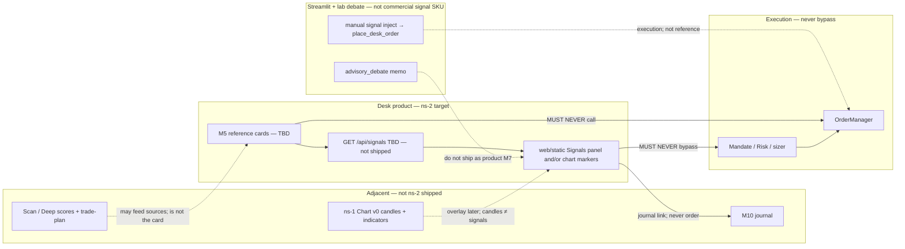

# 參考訊號設計頁｜Reference Signals Design

> **Status:** Draft（ns-2 / reference-signals）— 待 Owner／PM 審；**未 Accepted、未 merge 前唔作產品宣稱依據。Draft ≠ Accepted。Merge ≠ Accepted。**  
> **Binds under:** [ADR-003 + Addendum A](ADR-003-live-ai-trading-desk.md)（Accepted）> [MODULAR_ARCHITECTURE.md](MODULAR_ARCHITECTURE.md) > [AUDIT_REMEDIATION_PLAN_2026-10-21.md](AUDIT_REMEDIATION_PLAN_2026-10-21.md)（Confirmed items 1–5 **only**）> related Drafts：[BOUNDED_INTELLIGENCE_ACCEPTANCE.md](BOUNDED_INTELLIGENCE_ACCEPTANCE.md)（有界智能）／ [ACCOUNT_MANAGEMENT_DESIGN.md](ACCOUNT_MANAGEMENT_DESIGN.md)（管戶範圍）／ [LAB_PRODUCT_M7_BINDING.md](LAB_PRODUCT_M7_BINDING.md)（lab≠M7）／ [CHARTS_INDICATORS_DESIGN.md](CHARTS_INDICATORS_DESIGN.md)（ns-1 圖表／指標）。  
> **Index:** [ARCHITECTURE_DECISION.md](ARCHITECTURE_DECISION.md)。**ADR-002 is VOID.**  
> **North star（鎖定）：** 遠端交易台（TradingView-style 圖表／指標；Desk **v0 日線 K 線**已喺 `main` PR #36，唔等於官方 TradingView）；用戶可見可追溯日誌；**App 提供參考訊號**（建議買入／賣出、指標解讀、策略——**細節仍 planning**）；AI 幫管戶；迷你富途式 UX；**唔係**淨後台 Python 指標工具；真倉要過證據閘；Code Review 擋假 source／hardcode。  
> **Does not elevate:** Intent→M8／H1–H3、D7-DESIGN（雙目錄；**≠** ADR-003 D7 參考訊號）、Desk flatten product exception（G2）、fake verified／live、lab→`OrderManager`、產品 M7 實作已交付、參考訊號／SignalCard schema 已定、真倉已就緒。Issue #10 stays OPEN.  
> **Does not rewrite:** ADR-003 body；live Harness config／strategy／rules；L2 憲法只經 Proposal→Approve→Merge。本頁**propose** 產品範圍＋誠實閘＋v0 最小形狀；**唔**把 MODULAR §5.1 或本頁 JSON **凍結**成 Accepted SignalCard 憲法。  
> **Date:** 2026-10-23（Asia/Hong_Kong）  
> **Baseline SHA:** `5661f131a4a57234dc38a6e4191c7c31f2cab632`（`main`，含 ns-1 Desk charts v0 PR #36）

---

## 1. 目的｜Purpose

用**一頁**鎖定北極星項 **ns-2**：遠端 Desk 上 **參考交易訊號（reference / advisory signals）** 嘅產品範圍、現況誠實表、證據閘、同 v0 接受最小面。

本頁係**設計／接受頁**，唔係實作工單、唔係 SignalCard 已定稿、唔係「可上真倉」證書、唔係把 Scan 分數／worker `last_signals`／lab debate memo／Streamlit 手動注入當已交付參考訊號產品。

對齊缺口：ADR-003 北星同 **D7** 寫「App 提供參考訊號（建議買入／賣出、指標解讀、策略——細節仍規劃中）」；必須用戶可見、可解釋、寫入日誌、帶 Code Review 可核實 **sources**。MODULAR **M5** 仍 TBD（無 `backend/signals/`）。有界智能／管戶／lab≠M7／ns-1 圖表四頁唔寫參考訊號產品面。本頁補呢塊——**唔**擴大 2026-10-21 Confirmed remediation（Confirmed 維持 **1–5**；本頁**唔係** Confirmed item 6）。

---

## 2. 定義｜Definition

北極星原文精神：App **提供參考訊號**——買／賣**建議**、指標**解讀**、策略**說明**（細節仍 planning）。訊號係**參考／advisory**：幫用戶睇同追溯，**唔**自行落單、**唔** stamp `verified`／`live`、**唔**繞過 Mandate→Risk→`OrderManager`。

| 是（v0 設計範圍） | 不是 |
|-------------------|------|
| **參考／advisory：** 用戶可見嘅建議買／賣、指標解讀、策略說明；明確標 **planning／reference_only** | 已核實成交、`RISK_APPROVED`、broker fill、live 證明、或「系統已替你下單」 |
| **產品訊號落 FastAPI Desk + `web/static`**（ADR-003：Desk＝產品 UI） | 把 Streamlit 手動「信號注入」、worker `last_signals` JSON、Scan 排名當商業參考訊號 SKU |
| 每條露出嘅訊號帶 **sources[]**（vendor／asof／ref 可核實）同可解釋 why | 無 source 結論；hardcoded「必買」；假 summary 餵 Scan／Proposal／worker |
| 可寫入／連結 **用戶可見 journal**（traceable） | 靜默改 IntentStore；點擊訊號直接 `place_desk_order`／`process_signal` |
| ADR-003 **D7** 產品範圍＋誠實閘＋**proposed** v0 最小形狀（本頁） | 凍結 D7 確切 schema 為 Accepted 憲法；宣稱 SignalCard 已出貨 |
| Streamlit／lab debate 可保留研究 | Lab memo／委員會／Pine／pattern＝產品已交付或可觸發 live 單 |

**接受陳述：** ns-2＝遠端 Desk 上、對用戶誠實嘅**參考**訊號（來源可見、paper／live 唔混淆、訊號唔當成交、唔自行下單）。唔係「已經有完整策略產品／SignalCard」，亦唔係 Python-only 後台分數玩具充當交易台建議。

---

## 3. 現況（對齊本 SHA，唔發明）｜Repo truth

本節係設計約束。**Baseline `5661f13` 上，Desk 沒有已交付嘅參考訊號產品（無 SignalCard UI、無 `/api/signals`、無 `backend/signals/`）。** Scan 分數、Deep trade-plan、worker 週期摘要、lab 委員會 **≠** ns-2 已達。

| 面 | 現況（`5661f131a4a57234dc38a6e4191c7c31f2cab632`） | 含義 |
|----|-----------------------------------------------------|------|
| 產品 UI | Desk＝FastAPI + `web/static/index.html`；`web/src` React 平行／遺留 | 產品參考訊號必須落 `web/static`（或日後正式 Desk 前端），唔把未上線 React 當已出貨 |
| Desk Chart v0（ns-1 **code**） | PR #36：`lightweight-charts` **日線 K 線**＋volume＋閉合 overlay（SMA20／SMA50／EMA20／BB）＋ pane RSI／MACD；`GET /api/chart/{symbol}` 走 `equity_ohlcv`（Polygon 優先、Yahoo **labeled fallback**）；文案「Not TradingView, not live, not an order」 | **圖表層已有 v0 candles**（cite 誠實）。**無**參考訊號標記 overlay、無 Signals 面板、指標交叉**唔**下單 |
| ns-1 設計頁 | [`CHARTS_INDICATORS_DESIGN.md`](CHARTS_INDICATORS_DESIGN.md) 仍 **Draft**（其 baseline 係 PR #34 sparkline 敘事） | 設計頁 Draft ≠ 圖表未出貨；code v0 candles **唔**等於參考訊號已出貨 |
| Desk Scan | `GET/POST /api/scan*`：排名表 `total_score`／`fund_score`；Research 有 trade-plan（entry／stop／T1）＋ quant／risk-adj | **研究分數／計劃草稿**；**唔係**版本化 SignalCard；點名唔等於已過風控單 |
| Desk Research committee | `POST /api/lab/advisory`（`product: true` 仍 `places_order: false`）；文案 no-order | **lab debate 露出喺 Desk Research**＝研究 memo；**≠** 產品 M7；**≠** 參考訊號卡已交付 |
| Desk AI Mode 「Signals」 | `worker.last_signals` 最近約 6 條 `JSON.stringify`（來源 `TradingWorker.last_signal_summary`：過 `process_signal` 後嘅 `BUY` 摘要 ticker／action／qty／price／reason） | **執行路徑週期日誌**，唔係 M5 參考卡；唔 stamp planning／sources |
| Desk Journal | `GET/POST /api/journal`：訂單、風控拒絕、操作筆記；filled-only 文案 | P0 日誌**已有**；**未**有 `signal_ref`／SignalCard 連線產品 |
| IntentStore | `/api/intents` envelope：`verified: false`、`live: false`、`local`／`unverified`；**唔係**訂單 | L1 意圖帳；**完整 Intent→M8 仍 OPEN**；參考訊號 **唔**自動寫 Intent（除非另決，見 GS5） |
| 產品 API 缺口 | **無** `GET/POST /api/signals`；**無** `backend/signals/`；**無** `backend/trading/advisory/` | M5／產品 M7 **未交付** |
| MODULAR M5／§5.1 | 文件有 SignalCard **v0 draft — planning** JSON 草圖；Owns 指向 `recommender.py`／`trading_strategies.py`／`signal_pillars.py`；新建 `backend/signals/` **TBD** | **文件草圖 ≠ runtime 合約已 Accepted**；本頁唔把 §5.1 升格為憲法 |
| Worker 策略 | `backend/trading/strategies/*` `evaluate` → `SignalProcessor.process_signal` → Mandate→Risk→`OrderManager` | **錢路徑**；產出嘅 strategy signal **唔係**用戶面參考卡 |
| `signal_pillars` | `backend/agents/signal_pillars.py`：五柱分數餵 Scan／recommender／backtest | 研究／技術衍生；**未**做 Desk 參考訊號 API |
| Streamlit lab | `trading.section.last_signals` 顯示 worker 摘要；**手動信號注入**表單 → `place_lab_manual_order` → `place_desk_order`（經風控） | 注入＝**落單／shadow 執行**，**唔係**參考訊號；lab 唔升格產品 |
| 產品 M7 | `backend/trading/advisory/` **不存在**；lab `advisory_debate` 有隔離測 | M7 **OPEN**；lab **禁止**接 `OrderManager`（見 [LAB_PRODUCT_M7_BINDING.md](LAB_PRODUCT_M7_BINDING.md)） |

**誠實一句：** 而家用戶喺遠端 Desk 見到嘅係——**日線 K 線（ns-1 v0）**、Scan／Deep **分數同研究計劃**、AI Mode 裏 **worker 已處理買賣摘要**、Research 裏 **lab 委員會 memo（明示唔落單）**。**未**見到帶 sources、標 planning、可追溯、唔下單嘅參考訊號產品。ns-2 要設計嘅係後者，而唔係宣布前者已係 SignalCard。

---

## 4. Scope — Desk vs lab vs worker｜產品訊號落邊

產品參考訊號**先**落 FastAPI Desk + `web/static`。Streamlit 維持 lab／legacy。Worker 錢路徑維持 Mandate→Risk→`OrderManager`。**禁止**把 lab debate、Scan 分數或 worker `last_signals` 靜默當成已交付 ns-2。



| 關注點 | Desk（產品） | Streamlit／lab | Worker |
|--------|--------------|----------------|--------|
| **誰出貨** | 遠端交易台參考訊號面（§7 最小形狀） | 研究／舊 UI；手動注入係**落單**，唔餵「已有參考訊號產品」文案 | 策略評估→`process_signal`＝執行候選，唔係 M5 卡 |
| **而家用戶見到** | Chart v0 K 線；Scan 分數；AI Mode raw `last_signals`；Research lab memo | Plotly／last_signals 卡／注入表單 | heartbeat `last_signals` |
| **數據來源** | 應對齊 M2 vendor／asof；每卡 `sources[]` | lab 結論**唔可**當已核實 source | 策略 reason 字串 ≠ Code Review 可核 sources |
| **落單** | 只經 Desk 手動 Mandate→Risk→OM，或 worker 錢路徑 | 注入已走 `place_desk_order`；debate **禁止**接 OM | 唯一自動執行入口仍係 M8→M9 |
| **M7** | 產品 `backend/trading/advisory/` 仍 OPEN；若日後產 veto／tier，可做註解層，**唔寫**訂單 | `lab/advisory_debate` ≠ M7 | Worker **忽略** lab 改 top-N 當執行依據 |

參考訊號點擊／指標解讀／Scan 行**唔係** M9 入口。混層＝假產品（見 §6）。

---

## 5. 證據閘｜Evidence gates（訊號唔 stamp verified／live）

對齊 ADR-003 §4 C／D4／D7、有界智能頁 §6–7、管戶頁 §5、圖表頁 §5。參考訊號 UI／API **永遠**唔准用「有建議／有分數／有 memo／有 K 線」去 stamp `verified: true`／`live: true`。

| 閘 | 參考訊號含義 | 失敗必須看起來失敗 |
|----|--------------|--------------------|
| Paper ≠ live | Desk 頂欄 PAPER；訊號卡唔顯示 Live ready／真倉徽章 | 紙上建議 ≠ 真倉已就緒 |
| Filled-only | 圖上成交標記、journal fill **只**畫 **recorded fill** | 未成交 limit、shadow 估價、KPI 空倉、訊號建議價唔當 fill |
| 無 sources 就唔畫「已核實」 | `sources[]` 空 ⇒ 唔渲染為核實卡；M13 拒收假 source／假 summary | 空白／失敗 ≠ 假裝有策略產品 |
| 訊號 ≠ broker fill | 建議／解讀／策略說明係 **advisory** | 唔寫 `FILLED`／`RISK_APPROVED`；唔自行 submit |
| 唔繞過錢路徑 | 任何自動或一鍵下單仍要 Mandate→Risk→`OrderManager` | 訊號 click ≠ 落單；唔 bypass kill／mandate |
| Planning 標籤 | ADR-003 D7 確切 schema **仍 planning**；露出必須 badge `planning` 或 `reference_only` | 唔把本 Draft／MODULAR §5.1 當已定稿 |
| Seal／chart ≠ 訊號產品 | ns-1 有圖、P0 有 journal **唔等於** M5 已交付 | 睇到 K 線／分數 ≠ SignalCard 已出貨 |
| Lab memo ≠ 已核實 source | `POST /api/lab/advisory` 即使 `product: true` 仍 `places_order: false` | 委員會角色 ≠ 產品 M7 亦 ≠ ns-2 卡 |

**明文：** 未成交 limit ≠ 證據。Scan 高分 ≠ 已過風控。Worker `last_signals` ≠ 參考訊號產品。Lab debate ≠ M7。Paper 建議 ≠ live。本頁合入 ≠ D7 schema Accepted。

---

## 6. 分層｜Layers（data / overlay / reference markers / Intent→M8 / OrderManager）

五層必須分開；**混層＝假產品**。

| 層 | 係咩 | 可以 | 禁止 |
|----|------|------|------|
| **A. 市場數據** | OHLCV／volume；M2 ingress | 標 vendor、asof、interval、fallback | Hardcode 報價；fallback 當 paid verified |
| **B. 指標 overlay（ns-1）** | SMA／EMA／BB／RSI／MACD **衍生序列** | Desk Chart v0 已展示；公式／參數可見 | 交叉／超買超賣單獨下單；當 M8 已批 |
| **C. 參考訊號標記（ns-2）** | 建議買／賣、指標解讀、策略說明（ADR-003 **D7 still planning**） | 若露出：planning 標＋`sources[]`＋journal 可溯 | 本頁定稿 SignalCard 為 Accepted；無來源當已核實 Intent；stamp verified／live |
| **D. Intent→M8** | L1 IntentStore；H3 寫／H1 消費；仍 **OPEN** | 另決之後先考慮「參考卡 → 建議 Intent」 | **本頁唔**自動寫 Intent；唔把訊號當已消費 Intent |
| **E. OrderManager** | Mandate→Risk→M9 唯一執行 | Desk 手動單／worker 錢路徑 | 訊號 UI、lab debate、Scan、指標 **呼叫** OM |

Worker 策略 DataFrame 欄、Scan `technical_analyzer`／`signal_pillars` 分數、lab debate memo、AI Mode `last_signals`：**唔係** C 層已交付，亦**唔係** live 觸發。產品 M7（仍 OPEN）若日後產 veto／tier，可做 C 層註解，**唔寫**訂單。

---

## 7. v0 接受最小面｜UX minimum（proposed, Draft）

以下係 **Draft 建議**，Owner／PM Accepted 之前**未鎖**，亦**唔凍結** ADR-003 D7 確切 schema。達標先可稱「Desk 有參考訊號最小形狀（planning）」；未達標只可講「有 Scan 分數／worker 摘要／lab memo／圖表指標」。

| v0 建議有 | v0 明確唔做 |
|-----------|-------------|
| **可見：** 喺 Desk 產品面至少一處列出參考訊號（面板同／或圖表標記——放置見 GS2） | 完整策略市集、社交跟單、用戶自訂訊號引擎 |
| **可解釋：** 人類可讀 why（建議／解讀／策略說明至少一類；種類見 GS1） | 點擊訊號自動下單／bypass M8 |
| **可追溯：** 能連到 journal（`log_id`／`signal_ref` 或明確「尚未入帳」空態；見 GS3） | 把 worker `last_signals` 改名當已交付 M5 |
| **有 sources：** 每卡非空 `sources[]`（type／ref／asof／vendor）；空 sources 唔渲染為核實卡 | 假 source／hardcode 必買摘要 |
| **誠實標籤：** `planning` 或 `reference_only`；**永不** `verified`／`live` | 凍結 SignalCard 為 Accepted 憲法；宣稱 D7 已定稿 |
| **紙倉語意：** 頂欄 PAPER 不變；文案「參考、唔係成交」 | Stamp live ready；用訊號當 seal 通過 |
| **最小欄位形狀（proposed，未鎖）：** `schema_version`（標 planning）、`symbol`、`ts`、`kind`／`action`（種類未鎖）、`summary`／why、`sources[]`、`ui_badge` | 把 MODULAR §5.1 全欄（horizon／levels／score／provenance…）當已強制 runtime |

**Proposed v0 形狀（Draft only — 唔係 Accepted D7 schema）：**

```json
{
  "schema_version": "signal_card.v0.planning",
  "symbol": "AAPL",
  "ts": "ISO-8601",
  "kind": "TBD — buy_sell_suggestion | indicator_read | strategy_note",
  "action": "TBD — buy | sell | hold | interpret",
  "summary": "human-readable why",
  "sources": [
    {"type": "scan_field|ohlcv|news|manual", "ref": "string", "asof": "ISO-8601", "vendor": "polygon|yahoo|..."}
  ],
  "ui_badge": "planning | reference_only",
  "journal_ref": null,
  "verified": false,
  "live": false
}
```

對照：[`MODULAR_ARCHITECTURE.md`](MODULAR_ARCHITECTURE.md) §5.1 係**規劃草圖**；本塊係產品最小面 **propose**。兩者都**唔**因本頁合入而變成 Accepted 憲法。Owner 定稿前 UI 必須顯示 planning badge。

**非目標（本頁）：** 訊號 click → 自動訂單；完整策略 marketplace；官方訊號供應商接入；把 lab 委員會升級成產品 M7；自動寫入 IntentStore；期權／黃金訊號 SKU。

---

## 8. 開放決策（要 Gabriel 拍板）｜Open decisions（G-table）

本頁 **Draft** 只建議預設；**全部未鎖**。Accepted 之前唔寫進 runtime／Harness。

| ID | 問題 | 建議預設（未鎖） | 若另決會影響 |
|----|------|------------------|--------------|
| **GS1** | 訊號種類：買／賣建議 vs 指標解讀 vs 策略說明 vs 先做子集 | **v0 三種都允許露出，但每卡只屬一 `kind`**；唔默認「系統已幫你買賣」。買／賣建議必須寫明 **reference_only** | payload、UI 文案、同 Scan trade-plan 嘅邊界 |
| **GS2** | 放置：Chart overlay 標記 vs 獨立 Signals 面板 vs 兩者 | **v0 先獨立 Signals 面板**（Desk `web/static`）；Chart overlay **later**（唔阻塞 ns-1 candles）。兩者都唔下單 | M4 vs M5、圖表庫標記 API |
| **GS3** | 點樣連 journal | **v0 每卡可選 `journal_ref`**；無對應入帳就顯示「尚未入帳／唔係 fill」，**禁止**發明 fill 連線 | M10 schema、唔把建議價當成交 |
| **GS4** | 同產品 M7 advisory 關係 | **分開：** ns-2＝用戶面參考卡（M5）；M7＝帳戶級 veto／tier（仍 OPEN）。M7 產出可**註解**卡，**唔寫**訂單、唔替代 M5 | 唔把 lab debate 當 M7 亦唔當 ns-2 |
| **GS5** | 同 IntentStore 關係 | **維持 OPEN：參考訊號唔自動寫 Intent。** 用戶見到卡 ≠ `upsert_active_intent`。若日後要「採納為 Intent」，另開 Owner 決策＋唔繞 M8 | 防止混層 D／C；Intent→M8 仍 OPEN |
| **GS6** | 可唔可以「把 Scan 排名／Deep trade-plan 當 v0 SignalCard」？ | **唔可以當已交付 M5。** 分數／計劃可做 **source 輸入**；要另做帶 sources＋planning badge 嘅卡形 | 防止研究頁＝訊號產品 |
| **GS7** | 可唔可以「把 worker `last_signals`／Streamlit 注入當 ns-2」？ | **唔可以。** 前者係執行摘要；後者係落單表單 | 防止錢路徑冒充參考層 |

---

## 9. Draft vs still OPEN｜本頁合入後（docs only）

**Code／參考訊號產品唔因本頁變完成。** Status：**Draft** pending Owner／PM；**未 Accepted。Merge ≠ Accepted。** 未 Accepted、未 merge 前唔作產品宣稱依據。Confirmed remediation 仍係 **1–5 only**。

| ID | Status | Notes |
|----|--------|-------|
| **本設計頁** `docs/REFERENCE_SIGNALS_DESIGN.md` | **Draft**（pending Owner／PM; **not yet Accepted**） | Merge ≠ Accepted；**唔**凍結 D7 schema／SignalCard |
| 有界智能接受頁 | Draft（plan-14） | 接受條件；本頁專寫參考訊號面 |
| 管戶設計頁 | Draft（plan-15） | Desk vs worker 帳戶；本頁唔取代 |
| lab≠M7 綁定頁 | Draft（plan-16） | lab 唔接 OrderManager；lab memo 同樣唔接 |
| 圖表／指標設計頁 | Draft（ns-1） | Desk TV-style 圖表範圍；code v0 candles **≠** 本頁交付 |
| Desk 參考訊號產品／SignalCard UI | **OPEN（未交付）** | 現況＝分數／worker 摘要／lab memo |
| ADR-003 **D7** 確切 schema | **planning／OPEN** | 本頁只 propose 最小形狀；**唔** Accepted 憲法 |
| D7-DESIGN（雙目錄合併） | **OPEN** | **同名刀 ≠** ADR-003 D7 參考訊號；唔合併 `data/` vs `backend/data/` |
| Intent→M8／H1–H3／完整 M8 StrategyBase | **OPEN** | 本頁唔自動寫 Intent（GS5） |
| Desk flatten product exception（G2） | **OPEN** | 唔升格 |
| Fake verified／live | **OPEN** | 本頁只綁「訊號唔准 stamp」 |
| 產品 M7 `backend/trading/advisory/` | **OPEN（未交付）** | 唔由本頁實作 |
| AUDIT Confirmed remediation | **1–5 only** | **唔**加 item 6 |
| **Issue #10** | **OPEN** | Parent audit inventory remains OPEN |

---

## 10. 不得宣稱｜Must not claim

未 Accepted／未過對應閘之前，產品／文件／銷售／UI **禁止**宣稱或暗示：

1. **可上真倉／live ready／verified**（有建議 ≠ 真倉）。  
2. **參考訊號／SignalCard schema 已定稿**（ADR-003 D7 仍 planning；本頁唔凍結）。  
3. **Desk 參考訊號產品已交付**（Scan 分數／worker `last_signals`／lab memo／K 線 ≠ SignalCard）。  
4. **「已接入完整策略產品／訊號市集」。**  
5. **Intent→M8／D7-DESIGN／Desk flatten／產品 M7／issue 10 庫存已完成。**  
6. **Lab advisory debate = 產品 M7 或 ns-2**，或已接到 `OrderManager`。  
7. **訊號 click／指標交叉／Scan 高分／未成交 limit = 實盤證據或已下單。**  
8. **本 Draft 合入＝Accepted 憲法**（Accepted 之後先升格；仍唔改 runtime）。**Merge ≠ Accepted。**  
9. **ADR-002 仍有效**（VOID）。  
10. **ns-1 有 Desk v0 candles ＝ ns-2 已完成。**

---

## 11. Out of scope this page｜本頁／本週期唔做

- 改 runtime／Harness config／strategy／rules；實作 `/api/signals`、SignalCard UI、Chart 訊號 overlay、`backend/signals/`。  
- 實作 Intent→M8、D7-DESIGN、Desk flatten、產品 M7。  
- Stamp verified／live；凍結 ADR-003 D7 確切 schema 為 Accepted。  
- 訊號 click 自動下單；把 lab debate 接上 `OrderManager`。  
- 擴大 2026-10-21 Confirmed remediation（**保持 1–5**；本頁**唔係** item 6）。  
- 改寫 ADR-003 正文。復活 **ADR-002**。  
- 完整策略 marketplace；社交跟單；期權／黃金訊號 SKU。  
- Issue #10 stays OPEN（父審計庫存繼續開；本頁唔當庫存完成）。

---

## 12. 同其他文件關係｜Authority

衝突時（本頁最低，直至 Owner Accept）：

1. **ADR-003 + Addendum A**（決策＋北星＋D7 still planning＋§4 驗收＋Proposal 治理）  
2. **MODULAR_ARCHITECTURE**（M5／M7／M8／M9／M11；SignalCard §5.1 **planning** 草圖）  
3. **AUDIT_REMEDIATION_PLAN**（Confirmed items 1–5；P0 journal 先）  
4. **BOUNDED_INTELLIGENCE_ACCEPTANCE**（AI 能力切片接受條件）  
5. **ACCOUNT_MANAGEMENT_DESIGN**（管戶產品範圍）  
6. **LAB_PRODUCT_M7_BINDING**（lab≠M7；lab memo 唔接執行）  
7. **CHARTS_INDICATORS_DESIGN**（ns-1 圖表／指標；overlay ≠ 參考訊號已交付）  
8. **本頁**（ns-2 參考訊號產品範圍；Owner 接受後）  
9. 舊 roadmap／runbook（frozen；**ADR-002 is VOID**）

本頁**不改變** live RiskEngine／Kelly／mandate／kill 設定或交易 runtime。

---

*Drafted 2026-10-23 for ns-2 reference signals design page. Owner／PM 審批前維持 Draft。Merge ≠ Accepted. Issue #10 stays OPEN.*
